# 10단계 결과: 카메라 2대로 타겟 접근 감지

2026-10-28 ~ 2026-10-30 · 지원 · Jetson aip-1 (내 계정), YOLO11n-pose / YOLOE / EmbeddingGemma 2

- 장비: cam0 = USB 웹캠, cam1 = TP-Link VIGI C540-W IP 카메라(PTZ). IP 카메라는 Jetson에 랜선으로 직접 연결했다(camlink, 10.42.0.22, RTSP stream2 848x480 → 640x480). 연결 과정은 `10단계_IP캠_연결기록.md`에 있다.
- 사용 파일: `calib_intrinsics.py` v5, `preview_cams.py` v1, `ptz.py` v1, `calib_extrinsics.py` v4, `stereo.py` v2.1, `proximity_app.py` v3. 모두 `lab/prox/`에 사본이 있다.
- 프로그램은 사람 이미지를 저장하지 않는다. 남는 것은 바닥 좌표와 알람 기록뿐이다. 아래 화면은 웹 화면을 직접 캡처한 것이고, 사람 얼굴은 모자이크 처리했다.

## 한눈에 보기

| 단계 | 결과 |
| --- | --- |
| 10-1 렌즈 보정 | USB RMS 0.215 px, IP RMS 0.291 px |
| 10-2 위치 보정 | 재투영 평균 6.6 / 5.6 px, 카메라 위치 오차 131 / 42 cm (기준 미달). 그래도 두 카메라 삼각측량 오차는 대부분 1~10 cm |
| 10-3 ankle1 | 근접 알람은 정상. 접근 시작이 짧은 시간에 여러 번 찍히고, 이탈 알람 전에 사람을 놓침 |
| 10-4 stereo | 타겟 근처에서는 정확(0.54 m, 섬). 카메라 가까이 오면 한쪽 화면에서 잘려 위치가 사라짐 |
| 10-5 fused | 한 카메라 추정(single)이 거의 동작하지 않음. 원인은 10-2에서 카메라 높이가 1.2 m 이하로 계산된 것 |
| 10-6 글로 타겟 찾기 | "chair"로 두 카메라 모두에서 의자를 찾음. 위치 (2.40, 2.97), 줄자 값과 3 cm 차이 |

## 10-1 렌즈 보정

| 카메라 | RMS (px) | fx | fy | cx | cy | 사진 수 |
| --- | --- | --- | --- | --- | --- | --- |
| cam0 USB | 0.215 | 426.6 | 428.5 | 372.6 | 216.2 | 자동 선별 |
| cam1 IP | 0.291 | 456.5 | 604.2 | 319.8 | 247.6 | 자동 선별 |

- 체커보드는 A4 인쇄물을 상자에 붙여 썼다(완전히 평평하지는 않음).
- 처음 IP 카메라 RMS는 2.4~3.6 px였고 cy가 −133으로 터무니없었다. 원인은 모서리 보정 창(cornerSubPix 11 px)이 640x480 화면의 칸 크기(실제로 3~6 px 간격 필요)보다 컸던 것이다. 창 크기를 칸 간격에 맞게 자동으로 정하고(v5), 고차 왜곡 계수 k3을 고정하자 0.291 px가 됐다.
- IP 카메라는 fx와 fy가 다르다(비율 약 1.32). 848x480 영상을 640x480으로 가로만 줄였기 때문이고, 보정이 이 찌그러짐까지 함께 잡는다.
- 흔들린 사진을 막으려고 체커보드가 멈춰 있을 때만 찍고(v4), 오차가 큰 사진은 빼고 다시 계산했다.

## 10-2 위치 보정

### 좌표계

README의 축(x = 칠판 따라 오른쪽, y = 교실 뒤쪽, z = 위)은 왼손 좌표계(거울상)다. 이대로 계산하면 solvePnP가 "뒤를 보는 카메라"를 답으로 내서 위치 추정이 전부 실패한다(시뮬레이션으로 확인). 그래서 오른손 법칙(원점에서 x를 바라볼 때 y가 왼쪽, z 위)으로 바꿨다.

### 첫 장소 (사물함 벽 → 책상, 2026-10-29)

기준점 8개가 책상 근처 40x50 cm 안에 몰려 있었다. 재투영 3.87 / 6.91 px, 카메라 위치 오차 64 / 47 cm로 실패했다. 시뮬레이션 결과 몰린 점은 카메라 위치 오차 16~30 cm, 넓게 퍼뜨린 점 6개를 더하면 5~8 cm였다. 이 실패 뒤 장소를 바꿨다.

### 새 장소 (열린 바닥 + 의자, 2026-10-30)

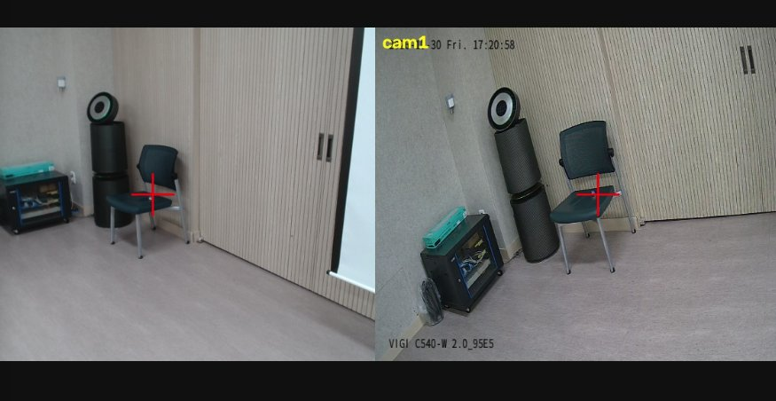
*preview_cams.py 화면. 왼쪽 cam0(USB), 오른쪽 cam1(IP). 빨간 십자 = 카메라 정면, 바닥의 흰 점 = 기준점 포스트잇*

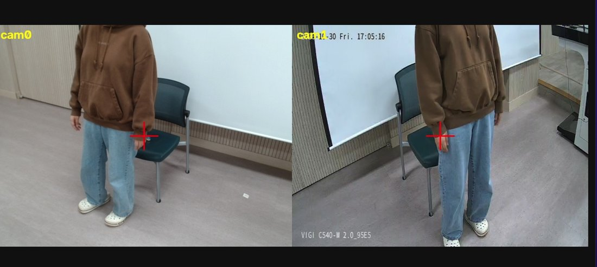
*각도 조정 전 확인 화면. 머리가 잘려 있어 두 카메라를 위로 조금 올렸다(어깨가 두 화면에 모두 보여야 삼각측량 가능)*

기준점 14개(계산용 12개 + 검증용 C, d): 바닥 A~H 8개, 의자 등받이 a·b(0.85 m), 의자 좌판 c·d(0.45 m), 벽 e(1.45 m)·f(1.25 m).

| 항목 | cam0 USB | cam1 IP | 기준 |
| --- | --- | --- | --- |
| 재투영 평균 mean_px | 6.64 | 5.57 | 3 이하 |
| 가장 큰 점 | e 16.7 px | a 11.0 px | |
| 계산 위치 (m) | (0.93, 0.82, 1.01) | (0.30, 1.56, 1.20) | |
| 줄자 위치 (m) | (0, 0, 1.45) | (0, 1.40, 1.45) | |
| 차이 | 131 cm | 42 cm | 20 cm 이내 |

두 카메라 삼각측량 오차(줄자 좌표와의 차이, cm): B 1.4, E 1.5, f 3.5, c 3.9, b 3.9, D 5.1, F 5.8, e 6.3, H 7.3, a 8.3, G 9.7, **C 11.2(검증)**, A 18.9, **d 21.2(검증)**.

- 기준 미달이지만 실습은 그대로 진행했다(지원 님 결정). 실제 위치 계산에 쓰는 삼각측량 오차가 14개 중 11개에서 10 cm 이하였기 때문이다.
- 두 장소 모두 계산된 카메라 높이가 실측보다 40 cm 이상 낮았다. 줄자 측정(카메라 위치, 기준점 좌표) 쪽 오차인지 클릭 오차인지는 확인하지 못했다. 이 높이 오차가 10-5의 실패로 이어졌다.
- 설치 조건의 한계: 두 카메라가 같은 벽에 1.4 m 간격으로 있어서 의자 위치에서 두 시선 사이 각도가 약 18도로 작다(권장 60~90도). 렌즈 높이 1.45 m도 서 있는 사람 어깨(1.3~1.4 m)와 거의 같다.

## 10-3 ~ 10-5 실행 기록

타겟 = 의자 좌판 가운데 (2.4, 3.0) 직접 지정, `--near 1.0`(기본), `--far 2.0`. 3 m는 이 공간에서 카메라 범위를 벗어나 2 m로 줄였다.

### 10-3 ankle1 (카메라 1대 + 발목)

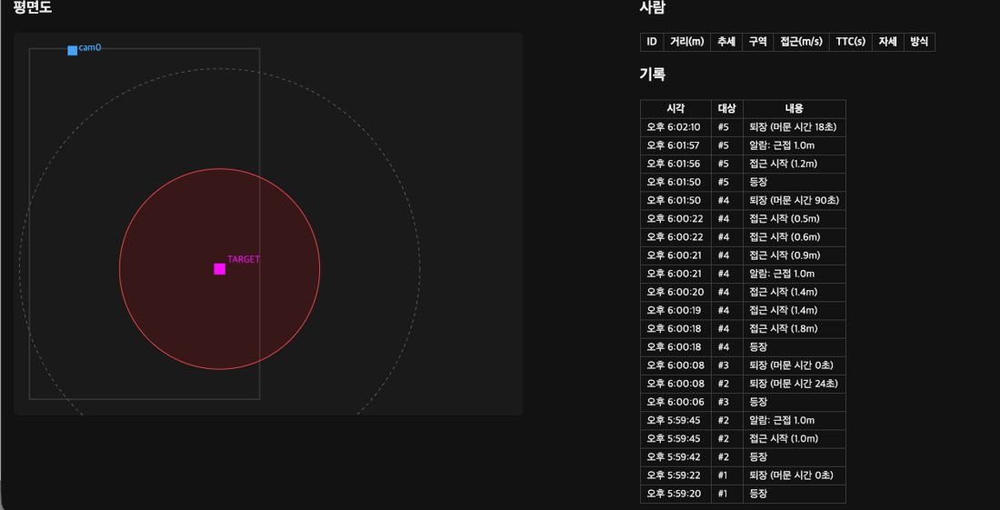
*10-3 첫 실행. 근접 알람은 뜨지만 #4의 '접근 시작'이 4초 동안 여러 번 찍혔고, 이탈 알람 없이 '퇴장'으로 끝난다*

- 근접 알람은 1.0 m 안에서 정상으로 떴다(#2, #4, #5).
- '접근 시작'이 여러 번 찍혔다. #4는 4초 동안 1.8 → 0.5 m로 6번 찍혔다. 지원 님 확인 결과 실제로 여러 번 다가갔다.
- 이탈 알람(2.0 m)은 한 번도 뜨지 않았다. 2 m 밖으로 가기 전에 화면 밖으로 나가거나 발목이 안 보여서 '퇴장'으로 끝났다.
- 머문 시간 0초로 바로 사라지는 짧은 트랙(#1, #3)이 있었다. 화면 가장자리에서 잠깐 잡힌 경우다.

### 10-4 stereo (두 카메라 + 어깨 삼각측량)

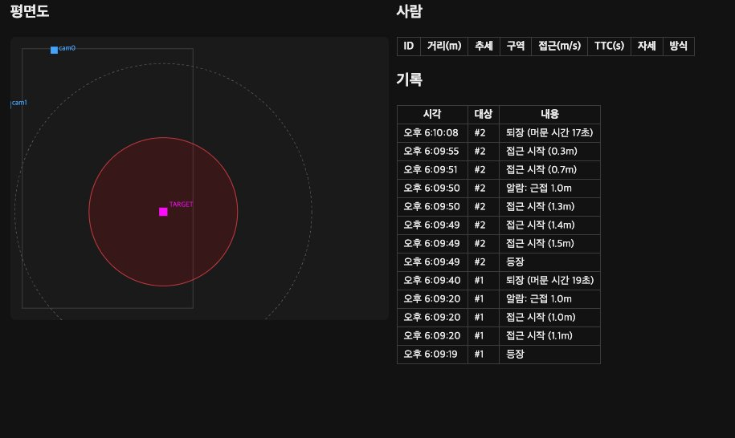
*10-4 실행 기록. 평면도에 cam1(왼쪽 가장자리)이 추가로 보인다*

- 의자 옆에 서 있을 때 거리 0.54 m, 자세 '섬'으로 맞게 나왔다.
- 근접 알람 정상(#1 0.5 m, #2 1.0 m, 0.2 m까지 접근 기록).
- 카메라 쪽으로 가까이 오면 위치가 사라졌다. 한쪽 화면에서 몸이 잘리면 두 카메라 짝이 안 맞기 때문이다. 발목이 가려지는 것과는 상관없다(stereo는 발목을 안 씀).

### 10-5 fused (stereo + 한 카메라 추정)

| 의자 옆 (두 카메라 모두 보임) | 카메라 가까이 (위치 없음) |
| --- | --- |
| 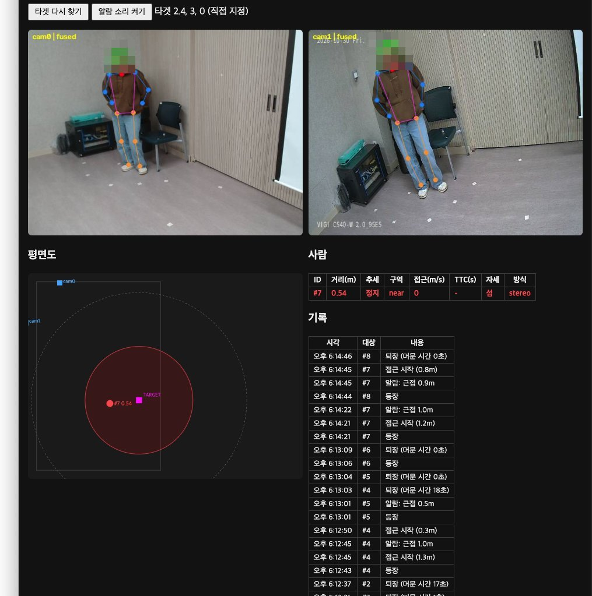 | 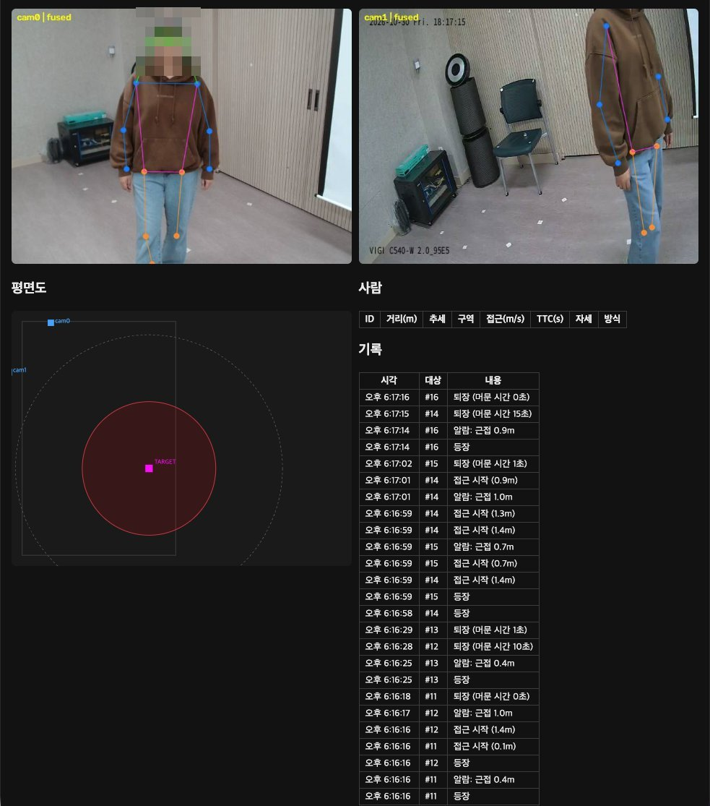 |
| stereo, 타겟까지 0.54 m, 섬, near | 두 화면에 관절이 잡혔는데 '사람' 표가 비어 있다 |

- 의자 근처에서는 stereo와 같다.
- 한 카메라에만 보일 때의 노란 점(single)은 처음 한 번만 나오고 이후 나오지 않았다. 두 화면에 모두 보이는데 카메라 가까이에서 위치가 없는 경우도 있었다.
- 원인: single은 시선이 높이 1.2 m(가정한 어깨 높이)에 닿는 곳을 위치로 잡는다. 그런데 10-2에서 카메라 높이가 1.01 / 1.20 m로 계산돼, 카메라가 그 높이보다 낮거나 같다. 아래를 내려다보는 시선은 1.2 m 높이에 닿지 않아 계산 결과가 '없음'이 된다. 카메라 가까이에서 두 화면에 다 보이는데 사라지는 것은, 보정 오차 때문에 재투영 오차가 짝짓기 기준(15 px)을 넘은 것으로 보인다.
- 고치려면 10-2를 다시 해서 카메라 높이가 실측(1.45 m)에 가깝게 나와야 하고, 카메라를 어깨보다 확실히 높은 곳(1.8 m 이상)에 두는 것이 좋다.

## 10-6 타겟 자동 찾기

`--target "chair"`

| 타겟 찾음 | 걸어서 접근 |
| --- | --- |
| 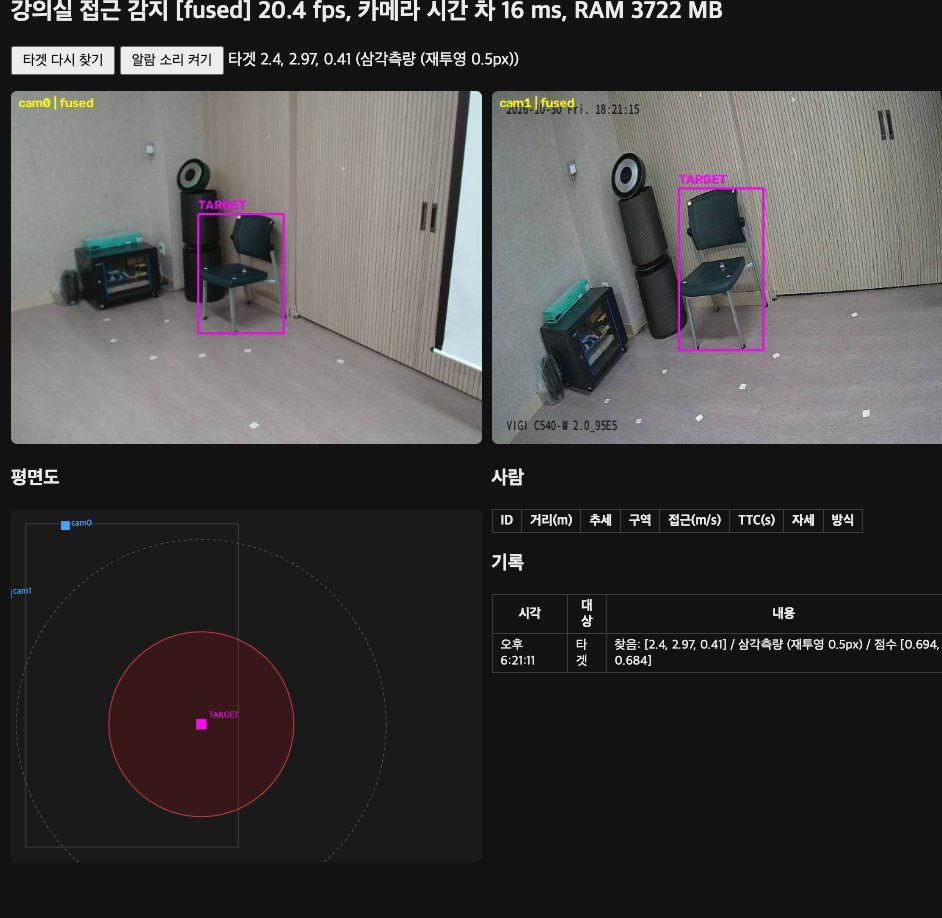 | 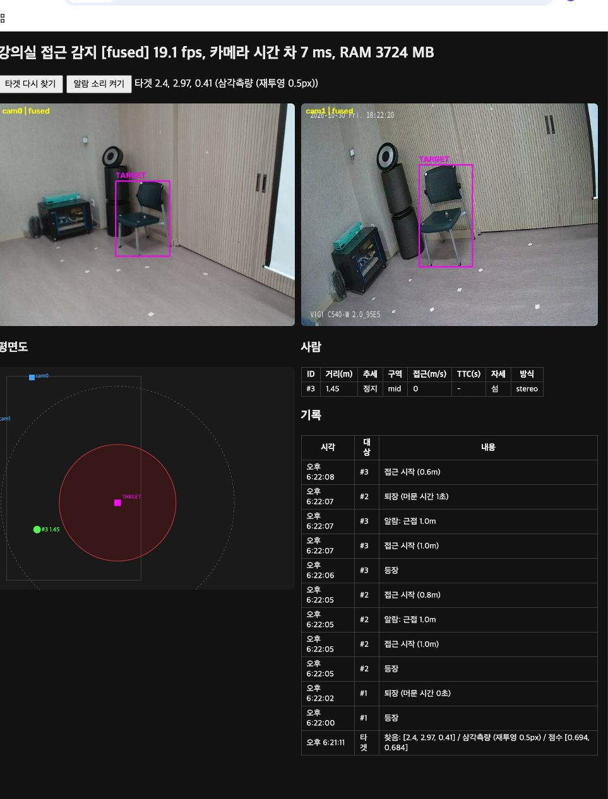 |
| 두 카메라 모두 의자에 TARGET 박스, (2.4, 2.97, 0.41) 삼각측량 0.5 px | 같은 타겟으로 근접·접근 알람 기록 |

| 항목 | 값 |
| --- | --- |
| 찾은 방식 | 두 카메라 모두 → 삼각측량 |
| 점수 (cam0, cam1) | 0.694, 0.684 (기준 0.15) |
| 위치 (m) | (2.40, 2.97), 높이 0.41 |
| 재투영 오차 | 0.5 px |
| 줄자 좌표와 차이 | 3 cm (좌판 높이 0.45 m와도 비슷) |
| 속도 / 메모리 | 19.1~20.4 fps, RAM 3.7 GB |

- 글로 찾은 타겟으로도 알람이 똑같이 떴다(#2, #3: 1.0 m 근접, 0.6~0.8 m 접근 시작).
- 의자 상자 중심은 사람 어깨보다 훨씬 작고 선명해서, 사람 위치보다 삼각측량이 잘 맞았다(재투영 0.5 px).

## 10-7 비교

### 방식별 거리 (같은 테이프 지점, 타겟까지 m)

| ankle1 | stereo | fused |
| --- | --- | --- |
| 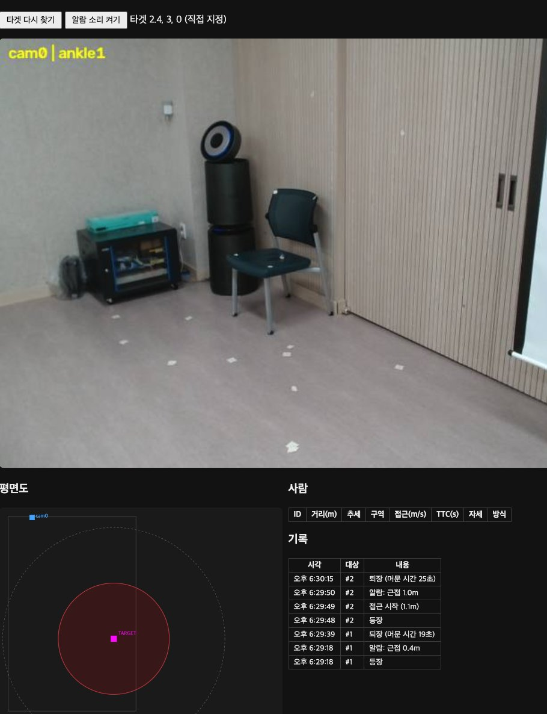 | 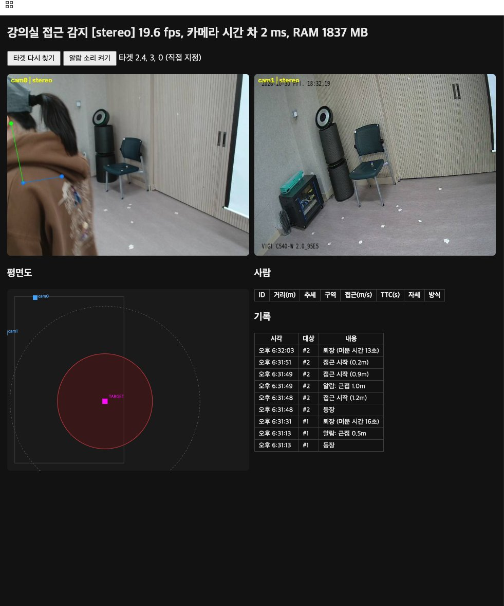 | 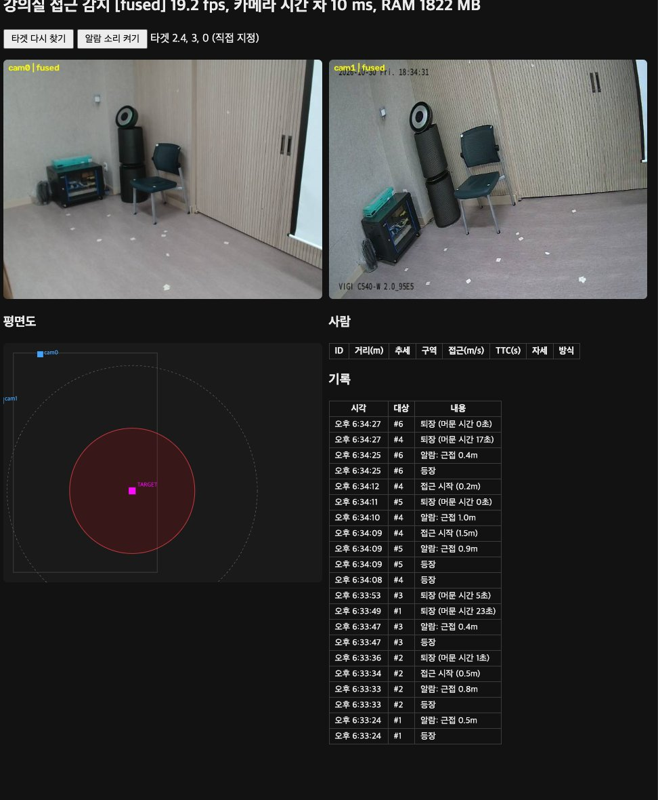 |
| 24.7 fps · 1941 MB | 19.6 fps · 2 ms · 1837 MB | 19.2 fps · 10 ms · 1822 MB |

*같은 순서(0.5 → 1.0 → 1.5 → 2.0 m 서기 → 앉기 → 한 카메라에만 보이기)로 돌린 뒤의 기록 표. stereo 화면의 cam0은 카메라 바로 앞에 선 순간이라 한쪽에만 보여 위치가 없다*

| 실제 거리·자세 | ankle1 (10-3) | stereo (10-4) | fused (10-5) |
| --- | --- | --- | --- |
| 0.5m, 서 있음 | 0.4 (근접 알람 거리) | 0.5 | 0.4~0.5 |
| 1.0m, 서 있음 | 1.0~1.1 | 1.0~1.2 | 0.8~1.0 |
| 1.5m, 서 있음 | 미기록 | 미기록 | 1.5 (#4 접근 시작) |
| 2.0m, 서 있음 | 미기록 | 미기록 | 미기록 |
| 의자에 앉음 | 미기록 | 미기록 | 미기록 |
| 한 카메라에만 보이는 위치 | (1대 방식) | 없음 | 없음 (single 미동작) |

- 값은 기록 표의 알람·접근 시작 거리에서 읽었다. 미기록 칸은 실행 중 '사람' 표 값을 받지 못한 곳이다.
- README의 3.0 m는 이 공간에서 카메라 범위 밖이라 1.5 m로 바꿨다. 책상이 없어 '책상에 앉음'은 '의자에 앉음', '책상 뒤'는 생략했다.

### 속도·메모리

| 모드 | fps | 카메라 시간 차 (ms) | RAM (MB) |
| --- | --- | --- | --- |
| ankle1 | 24.7 | 0 (카메라 1대) | 1941 |
| stereo | 19.6 | 2 | 1837 |
| fused | 19.2 | 10 | 1822 |
| fused + 글 타겟(10-6) | 19.1~20.4 | 7~16 | 3722 |

- 카메라 2대를 쓰면 1대보다 약 5 fps 느려진다(관절 추정을 두 장 함께 처리).
- 10-6은 YOLOE와 EmbeddingGemma 2를 추가로 올려 RAM이 약 1.9 GB 늘었다.
- IP 카메라 지연에도 불구하고 카메라 시간 차는 2~16 ms로 작았다(`--lag` 없이 실행). README 기준 80 ms보다 충분히 작다.

## 배운 점

1. 위치 보정의 질은 기준점 배치가 좌우한다. 한곳에 몰린 점은 카메라 위치를 50 cm 이상 틀리게 한다. 넓게, 높이를 섞어 퍼뜨려야 한다.
2. 보정 숫자(mean_px, 카메라 위치)가 나빠도 타겟 근처의 삼각측량은 쓸 만했다. 하지만 카메라 가까이나 한 카메라 추정처럼 보정 오차가 커지는 곳에서는 바로 무너졌다.
3. 카메라 설치 조건(높이 1.8 m 이상, 시선 각도 60~90도)은 계산 방식의 전제다. 카메라 높이가 가정한 어깨 높이보다 낮으면 한 카메라 추정(10-5)은 원리상 동작할 수 없다.
4. 물체(의자)는 사람보다 삼각측량이 잘 맞는다. 박스 중심이 안정적이기 때문이다.
