# Jetson EmbeddingGemma 2 실습 최종 보고서 (1~10단계)

2026-10-23 ~ 2026-10-30 실습 · 2026-11-02 총정리 · 지원 (AIGJ_01_017)

## 목차

1. 요약
2. 실습 환경
3. 1~2단계 환경 준비와 모델 설치
4. 3~7단계 임베딩 기초와 미세 조정
5. 8단계 웹캠 물체 검출과 검색
6. 9단계 사람 동작·행동 인식
7. 10단계 카메라 2대 접근 감지
8. 공용 장비 원칙과 결정 기록
9. 종합 결론과 한계
10. 제출 파일 구성

## 1. 요약

Jetson Orin Nano Super 8GB(여러 학생이 계정별로 공유)에서 EmbeddingGemma 2를 설치하고, 텍스트·사진·동영상·음성 검색부터 웹캠 응용(물체 검색, 동작 인식, 접근 감지)까지 README의 1~10단계를 진행했다. 10-8(이동 타겟)만 하지 않았다.

| 단계 | 한 일 | 핵심 결과 |
| --- | --- | --- |
| 1 환경 준비 | SSD 마운트, 성능 모드·스왑, JetPack 7용 PyTorch | R39(README 표에 없는 새 버전)를 JetPack 7 경로로 판단, `torch 2.14.1+cu132` GPU 검증 통과 |
| 2 패키지·모델 | sentence-transformers, 모델 다운로드, `eg2.py` | `(768,)` 확인. 계정별 실습을 위해 설치를 `system_setup.sh` + `user_setup.sh`로 분리, 모델은 `/ssd/hf` 공용 |
| 3 텍스트 | 한국어 질의-문서 검색 | 768·256·128차원 모두 정답 1위 |
| 4 사진·영상 | 글로 사진·영상 찾기 | 사람 있음/없음은 정확, 사람 수는 구분 못 함. 장비 FFmpeg 문제를 PyAV로 우회 |
| 5 음성 | 글로 소리 찾기 | 경보음·소음·말 내용은 맞힘, "말소리인지"는 못 가림 |
| 6 성능 | 구성별 RAM·지연·GPU | 전체 구성 RAM 4.66 GB, GPU 최대 1.77 GB. 프로세스당 약 1.7 GB는 고정비 |
| 7 미세 조정 | 강의실 데이터 282쌍으로 4.3분 학습 | accuracy@1 0.850 → 0.933, 128차원 0.767 → 0.850, 일반 문장 유지 |
| 8 웹캠 검색 | YOLO / 임베딩 재라벨 / YOLOE 비교 | 재라벨이 스마트폰·세탁기·건전지 오인식을 바로잡음, YOLOE는 건전지를 처음부터 맞힘 |
| 9 동작 인식 | 규칙 → 시간 안정화 → GRU 학습 | 다수결로 깜빡임 제거(악수 11 → 1). 학습 모델로 박수·팔짱 인식. 행동 패턴은 규칙(3/4)이 모델(2/4)보다 나음 |
| 10 접근 감지 | 카메라 2대 보정, 삼각측량, 알람 | 타겟 근처 삼각측량 1~10 cm, 글("chair")로 찾은 타겟 3 cm 오차. 보정 오차로 한 카메라 추정(fused)은 실패 |

## 2. 실습 환경

| 항목 | 값 |
| --- | --- |
| 장비 | Jetson Orin Nano Super 8GB, L4T R39, Ubuntu 24.04 (호스트 aip-1, 학생별 계정. 내 계정 1개 사용) |
| GPU 드라이버 | 595.78 / CUDA 13.2, CUDA 툴킷(nvcc) 없음 |
| 저장 장치 | 루트 SD카드 116 GB, NVMe SSD 234 GB를 `/ssd`에 마운트 |
| Python 환경 | Python 3.12, venv `~/eg2`, torch 2.14.1+cu132, torchvision 0.29.1+cu132, transformers 5.20.1, sentence-transformers 6.2.0 |
| 모델 | `google/embeddinggemma-2` (bfloat16), 공용 캐시 `/ssd/hf` |
| 카메라 | USB 웹캠 1대(8~10단계), TP-Link VIGI C540-W IP 카메라 1대(10단계) |
| 작업 방식 | 맥북에서 파일 작성 → `scp`로 내 계정 `~/eg2-lab`에 복사 → Jetson에서 실행, 웹 화면은 맥북 브라우저(Tailscale 주소)로 확인 |

소프트웨어는 위가 아래를 불러 쓰는 층 구조다.

| 층 | 역할 | 설치 위치 |
| --- | --- | --- |
| `eg2.py`의 `load()` | 필요한 인코더(텍스트/비전/오디오)만 골라 모델을 GPU에 올림 | 개인 `~/eg2-lab` |
| sentence-transformers | 모델을 불러오고 `encode()`로 벡터 변환 | 개인 venv `~/eg2` |
| transformers | 신경망 구조와 가중치 파일(`/ssd/hf`) 읽기 | 개인 venv `~/eg2` |
| PyTorch (cu132, CUDA 런타임 포함) | GPU 계산 | 개인 venv `~/eg2` |
| GPU 드라이버, Jetson GPU | 하드웨어 | 시스템 |

## 3. 1~2단계 환경 준비와 모델 설치

### 목적

1단계는 Jetson GPU에서 파이썬 계산이 돌아가는 바탕을 만들고, 2단계는 그 위에 EmbeddingGemma 2를 올려 문장을 768차원 벡터로 바꿀 준비를 한다.

### 진행

1. **SSD 마운트:** NVMe(234 GB)를 `/ssd`에 마운트하고 `/etc/fstab`에 등록해 부팅 때 자동으로 붙게 했다. Hugging Face 모델 캐시를 `HF_HOME=/ssd/hf`로 옮겼다.
2. **JetPack 판별:** `/etc/nv_tegra_release`가 **R39**였다. README 표(R36 = JetPack 6, R38 = JetPack 7)에 없는 버전이라 추가로 확인했다. Ubuntu 24.04, Python 3.12, 드라이버 CUDA 13.2 조합이므로 JetPack 7 경로(cu132 휠)로 정했다. `/usr/local/cuda`가 없어 nvcc도 없지만, torch 휠에 CUDA 런타임이 들어 있어 이 실습에는 필요 없었다. 수 GB짜리 `nvidia-jetpack`은 설치하지 않았다.
3. **설치 스크립트:** README 1~2단계 명령을 `jetson_setup.sh` 하나로 묶어 관리자 계정(aip-1)에서 실행했다. 순서는 성능 모드(`nvpmodel -m 0`, `jetson_clocks`) → 스왑 8 GB → apt 패키지와 venv → PyTorch 설치와 GPU 행렬 곱 검증 → torch 버전을 `torch-pin.txt`로 고정한 채 sentence-transformers 설치 → torchaudio 제거(README Q7의 CUDA 13.0/13.2 충돌 예방) → `check.py`, `eg2.py` 작성과 모델 로드다. `set -euo pipefail`로 한 단계라도 실패하면 멈춘다.
4. **계정별 실습으로 분리:** 실습은 개인 과제이고 학생마다 계정이 따로 있다. sudo가 필요한 부분과 계정별 부분을 나눠 두 파일로 만들었다.
   - `system_setup.sh`: 장비당 1번, 관리자가 sudo로. apt 패키지, 성능 모드, 스왑, `/ssd/hf`를 `aiplab` 그룹 공용 폴더로 만들고, 계정을 `aiplab`·`video`(웹캠) 그룹에 추가한다.
   - `user_setup.sh`: 계정마다 1번, 본인이 sudo 없이. 홈에 venv `~/eg2`, torch, sentence-transformers, `~/eg2-lab`(check.py, eg2.py)을 만들고 모델 로드까지 확인한다. 이후 `eg2` 한 단어로 venv 켜기와 폴더 이동을 한다.

### 결과

| 확인 항목 | 기대값 | 결과 |
| --- | --- | --- |
| GPU 연산 (`torch.cuda.get_device_capability()`, 행렬 곱) | `(8, 7) True` | 통과 |
| `check.py` | `torch 2.14.1+cu132 cuda True` | 통과 |
| `eg2.py`로 문장 1개 임베딩 | `(768,)` | 통과 (내 계정) |
| 루트 디스크 여유 | 15 GB 이상 | 70 GB 남음 (계정당 venv 약 5 GB) |

### 트러블슈팅

| 증상 | 원인 | 해결 |
| --- | --- | --- |
| R39가 README 버전 표에 없음 | README 작성 이후 나온 L4T | Ubuntu·Python·CUDA 버전으로 JetPack 7 경로를 판단 |
| `nvcc: command not found`, `/usr/local/cuda` 없음 | CUDA 툴킷 미설치 | torch 휠에 CUDA 런타임이 들어 있어 설치하지 않음 |
| 내 계정에 모델이 개인 폴더(`~/.cache/huggingface`)로 한 벌 더 받아짐 (약 3 GB) | `aiplab` 그룹 추가 후 **재로그인 전에** `user_setup.sh`를 실행해 `/ssd/hf` 쓰기 권한이 없었고, 스크립트가 멈추지 않고 개인 캐시로 넘어감 | 재로그인 후 `~/.bashrc`의 HF_HOME을 `/ssd/hf`로 바꾸고 개인 사본 삭제. `HF_HUB_OFFLINE=1`(다운로드 차단) 상태에서 `(768,)`이 나와 공용 모델을 읽는 것을 확인 |
| 설정을 바꿨는데 `echo $HF_HOME`이 예전 값 | `.bashrc`는 터미널을 열 때 한 번만 읽힘 | `source ~/.bashrc` 또는 새 터미널 |
| `setup.log`에 예전 경로가 남아 있음 | 로그는 실행 당시 기록이라 바뀌지 않음 | 현재 상태는 `.bashrc`와 `echo $HF_HOME`으로 확인 |

모델 파일은 실행할 때 **읽기만** 하므로 공용으로 둬도 각자의 실습은 섞이지 않는다. 각자 작성한 코드, 결과, 7단계 학습 모델은 모두 본인 홈에 저장된다. 동시에 쓸 때 실제로 부딪히는 것은 파일이 아니라 8 GB 메모리다(6단계 참고).

## 4. 3~7단계 임베딩 기초와 미세 조정

3~5단계에서 가장 큰 문제는 장비 FFmpeg였다. Jetson의 FFmpeg는 NVIDIA판(`8.0.1-nvidia1`)으로 swscale과 lavfi가 빠진 빌드라서, torchcodec(동영상·음성 읽기)과 README의 소리 생성 명령이 동작하지 않았다. 공용 장비 설정은 건드리지 않고 내 venv 안에서 PyAV, librosa, numpy로 우회했다.

### 3단계 텍스트 검색 (test_text.py)

#### 목적

1. 한국어 질의가 의도한 정답 문서와 짝지어지는지 확인한다.
2. 임베딩을 768 → 256 → 128차원으로 앞에서부터 잘라도 같은 짝을 찾는지 본다(Matryoshka 절단).

#### 방법

문서 4개(정답 후보 2개: CO2 환기, 에어컨 온도 / 방해 문장 2개: 조도, Jetson)와 질의 2개를 임베딩했다. 문서에는 `Document`, 질의에는 `SearchQuery` 프롬프트를 붙였다. 코사인 유사도(`q @ d.T`)로 1위를 골랐다. 정답 짝은 README 작성자가 정해 둔 것이고 코드는 정답을 모른다.

#### 결과

| 차원 | 질의 시간 | "수업 중에 졸리고 머리가 맑지 않아요" → CO2 문장 | "여름에 냉방 몇 도로…" → 에어컨 문장 |
|---|---|---|---|
| 768 | 198 ms | 0.717 (1위) | 0.725 (1위) |
| 256 | 175 ms | 0.734 (1위) | 0.754 (1위) |
| 128 | 174 ms | 0.785 (1위) | 0.810 (1위) |

#### 분석

- **의미 검색이 된다.** "졸리다"와 "CO2"는 단어가 겹치지 않는데도 1위로 짝지어졌다.
- **차원을 줄이면 점수가 오른다(0.717 → 0.785).** 성능이 좋아진 게 아니다. 벡터가 짧아지면 세부 정보가 줄어 모든 문장이 서로 비슷해 보인다. 그래서 점수는 같은 차원 안에서만 비교하고, 차원이 다르면 1위 유지 여부만 본다.
- **차원을 줄여도 속도는 같다(175 ↔ 174 ms).** 모델은 항상 768개를 다 계산한 뒤 앞부분을 자른다. 768의 198 ms는 첫 실행 준비 시간이 섞인 값이다. 줄이는 이득은 저장 공간과 비교 계산에서 나온다(문서 100만 개 기준 768차원 약 3 GB → 128차원 약 0.5 GB).

#### 트러블슈팅

| 증상 | 원인 | 해결 |
|---|---|---|
| 복사한 test_text.py가 내 계정에 없음 | `scp ... aip-1@...:~/`로 관리자 계정 홈에 보냄 | `scp test_text.py <USER>@<JETSON_IP>:~/eg2-lab/` (계정과 폴더 둘 다 지정) |
| venv와 실습 폴더 혼동 | `~/eg2`(패키지)와 `~/eg2-lab`(코드)는 나란히 있는 별개 폴더 | `source ~/eg2/bin/activate`는 폴더 이동이 아니라 쓸 Python을 바꾸는 것. 별칭 `eg2`가 켜기와 이동을 한 번에 함 |

### 4단계 사진·동영상 검색 (test_vision.py)

#### 목적

글로 쓴 질의가 알맞은 사진과 동영상을 찾는지 확인한다. 글과 사진이 같은 768차원 공간에 들어가므로 3단계와 같은 유사도 계산으로 검색한다.

#### 방법

`load(vision=True)`로 비전 인코더를 올렸다. 직접 찍은 10초 클립 `clip.mp4`와, 거기서 뽑은 `frame_01~05.jpg`를 썼다. 장면은 01~03이 사람 없음(03은 팔 일부), 04~05가 두 사람이다.

README 질의(빈 강의실, 수업 중, 화이트보드)는 클립에 없는 장면이 섞여 채점이 안 됐다. 그래서 v2에서 클립 내용에 맞게 질의를 바꾸고 5장 전체 순위를 출력했다.

#### 결과 (v3 최종)

| 질의 | 순위 (점수) | 판정 |
|---|---|---|
| 사람이 아무도 없는 빈 공간 | 01 (0.646), 03, 02, 05, 04 (0.576) | 정답. 사람 없는 3장이 1~3위 |
| 두 사람이 함께 있는 장면 | 05 (0.633), 01, 02, 04 (0.610), 03 | 1위는 맞지만 04가 4위. 차이 0.01 안쪽이라 사실상 구분 못 함 |
| 카메라를 바라보는 사람의 얼굴 | 05 (0.671), 01, 03, 02, 04 (0.598) | 05는 2위보다 0.045 높아 확실히 고름. 04는 꼴찌 |

동영상(10장 추출) 유사도는 빈 공간 0.620, 두 사람 0.638, 얼굴 0.659였다. 사람이 나오는 클립이라 사람 질의가 더 높았고, 방향은 맞다.

| 측정 | 값 |
|---|---|
| 사진 임베딩 | 장당 약 751 ms (첫 호출 준비 시간 포함) |
| 동영상 임베딩 | 10초 클립 5.1초 (PyAV, 1초에 1장 × 10장) |
| GPU 메모리 최대 | 1.20 GB |

#### 분석

- **있다/없다는 잘 가린다.** 빈 공간 질의는 5장 순서가 완벽했다.
- **사람 수는 약하다.** "두 사람" 질의에서 04가 사람 없는 사진들과 점수가 같았다. 사물이 몇 개인지 세는 건 임베딩 검색이 약한 부분으로 알려져 있다.
- **04가 계속 낮다.** 04에서는 사람이 작거나 덜 보이는 것으로 추정한다(사진으로 확인하지는 않았음).
- **점수가 좁게 몰린다(0.58~0.67).** 같은 배경에서 뽑은 장면이라 사진끼리 거의 비슷하다. 제대로 비교하려면 확실히 다른 장면 사진을 섞어야 한다.

#### 트러블슈팅

이 단계에서 가장 오래 걸린 문제다. 순서대로 적는다.

1. **`ImportError: torchcodec is not installed`**: transformers 5.x는 동영상을 torchcodec으로만 읽는다(`torchvision.io.read_video`는 0.26에서 삭제됨). → `pip install -c ~/eg2/torch-pin.txt torchcodec`. 이 설치는 내 계정에만 적용된다. `-c`로 torch 버전을 고정해서 Jetson용 torch가 일반판으로 덮어쓰이지 않게 했다. 설치 후 `python check.py`로 torch가 그대로인지 확인했다.
2. **`RuntimeError: Could not load libtorchcodec`**: FFmpeg 8용 로딩에서 `libswscale.so.9`를 못 찾았다. `ldconfig -p`로 보니 `libavutil.so.60`은 있고 libswscale은 없었다.
3. **원인 확인:** `dpkg -S /usr/bin/ffmpeg` 결과 `ffmpeg 7:8.0.1-nvidia1` 패키지였다. NVIDIA가 Jetson용으로 만든 FFmpeg가 라이브러리를 한 패키지에 묶어 둔 것이다. 5단계에서 본 빌드 설정에 `--disable-swscale`이 있어 swscale을 일부러 뺀 빌드임이 확인됐다. `libswscale9`는 apt에서 받을 수 없다(`Candidate: (none)`).
4. **판단:** Ubuntu판 libswscale을 섞으면 NVIDIA판과 충돌할 수 있다. 공용 장비 설정을 바꾸면 다른 학생에게도 영향이 가므로 장비 FFmpeg는 그대로 두었다.
5. **해결 (v3):** 기본 방식이 실패하면 PyAV(`av` 패키지)로 1초에 1장씩 꺼내 모델에 동영상으로 넘긴다. PyAV는 FFmpeg를 자기 안에 담고 있어 장비 FFmpeg와 무관하고, venv 안에만 설치된다. 출력의 `[방식: ...]`으로 어느 경로를 썼는지 확인한다.

곁가지 문제도 두 가지 있었다.

| 증상 | 원인 | 해결 |
|---|---|---|
| `dpkg -S /lib/.../libavcodec.so.62`가 "no path found" | Ubuntu 24.04는 `/lib`가 `/usr/lib`로 가는 바로가기라 `/lib` 경로로 조회하면 못 찾음 | `/usr/lib/...` 경로로 다시 조회 |
| v3로 고쳤는데 예전 결과가 그대로 나옴 | Jetson에 v1 파일이 남아 있었음(덮어쓰기 안 됨) | 질의 문구와 `grep -n "v3" test_vision.py`로 파일 버전을 확인한 뒤 다시 scp |

사진 장당 시간은 1276 → 880 → 769 → 751 ms로 줄었다. 모두 첫 호출 준비 시간이 포함된 값이라, 실행할 때마다 캐시가 데워진 차이로 보인다.

### 5단계 음성 검색 (test_audio.py, make_sounds.py)

#### 목적

`load(audio=True)`로 오디오 인코더를 올리고, 글로 쓴 질의가 알맞은 소리 파일을 찾는지 확인한다. 입력은 16 kHz 모노여야 한다.

#### 방법

| 파일 | 내용 | 만든 방법 |
|---|---|---|
| speech.wav | "강의실이 너무 덥습니다. 에어컨을 켜 주세요." (3.2초) | 맥북 `say -v Yuna` → `afconvert`로 16 kHz 모노 변환 |
| beep.wav | 1 kHz 사인파 3초 | make_sounds.py (numpy) |
| noise.wav | 핑크 노이즈 5초 | make_sounds.py (numpy) |

README는 `sudo apt install espeak-ng`으로 말소리를 만든다. 이 명령은 장비 전체에 설치되므로 맥북 음성으로 대신했다. test_audio.py는 v2에서 질의 2개를 더해 틀린 이유를 나눠 봤다.

#### 결과 (v2)

| 질의 | 순위 (점수) | 판정 |
|---|---|---|
| 덥다고 냉방을 요청하는 목소리 | noise 0.650, speech 0.647, beep 0.622 | 근소하게 틀림 |
| 날카로운 경보음 | beep 0.701, noise 0.665, speech 0.664 | 정답 |
| 웅웅거리는 배경 소음 | noise 0.679, beep 0.670, speech 0.639 | 정답 |
| 사람이 말하는 목소리 | beep 0.654, speech 0.641, noise 0.634 | 틀림 |
| 에어컨을 켜 달라는 말 | speech 0.695, noise 0.650, beep 0.596 | 정답. 1·2위 차이가 가장 큼 (0.045) |

| 측정 | 값 |
|---|---|
| 오디오 임베딩 | 파일 3개(11.2초 분량) 1회차 1623~2068 ms, 2회차 408~449 ms |
| GPU 메모리 최대 | 1.13 GB |
| 입력 방식 | librosa 배열 (파일 경로 방식은 torchcodec 오류로 실패) |

#### 분석

- **말의 내용은 알아듣는다.** 녹음된 문장의 단어("에어컨", "켜")가 들어간 질의는 확실하게 맞혔다.
- **소리의 종류(말소리인지)는 못 가린다.** "사람이 말하는 목소리"는 beep이 1위였다.
- **바꿔 말한 질의는 약하다.** "냉방"처럼 다른 단어로 표현한 질의는 근소하게 틀렸다. 3단계 텍스트에서는 단어가 안 겹쳐도 맞혔던 것과 대조적이다.
- **잠정 결론이다.** 파일이 3개뿐이고 말소리가 합성 음성 1개라 일반화하기 어렵다. 마이크로 직접 녹음해 비교하면 더 확실해진다(README 선택 과제).

#### 트러블슈팅

| 증상 | 원인 | 해결 |
|---|---|---|
| `ffmpeg -f lavfi ...`에서 `Unknown input format: 'lavfi'` | NVIDIA판 FFmpeg가 `--disable-everything`로 빌드돼 lavfi 장치와 sine·anoisesrc 필터가 없음 | make_sounds.py: numpy로 파형을 계산하고 soundfile로 16 kHz 모노 wav 저장. venv에 이미 있는 패키지라 설치할 것 없음 |
| 파일 경로 입력 시 `Could not load libtorchcodec` | 4단계와 같은 원인 (transformers가 오디오 파일도 torchcodec으로 읽음) | librosa로 직접 읽어 16 kHz 모노 배열로 넘김. FFmpeg를 쓰지 않음 |
| espeak-ng 설치에 sudo 필요 | apt 설치는 장비 전체에 적용 | 맥북 `say` + `afconvert`로 말소리 생성 |
| v1에서 실패 메시지가 두 번 찍히고 2회차 시간이 부풀려짐 | 시간을 두 번 재면서 실패하는 기본 방식을 매번 다시 시도 | v2: 한 번 실패하면 기억해 두고 2회차에는 바로 배열 방식으로 |

### 단계 간 비교 (6단계 측정 표용)

| 구성 | 올린 인코더 | 지연 | GPU 메모리 최대 |
|---|---|---|---|
| 텍스트 전용 | 텍스트 (270M) | 질의 2개 약 175 ms | 측정 안 함 |
| +비전 | 텍스트+비전 (약 440M) | 사진 장당 약 751 ms*, 10초 동영상 5.1초 | 1.20 GB |
| +오디오 | 텍스트+오디오 (약 570M) | 소리 3개(11.2초) 2회차 약 410~450 ms | 1.13 GB |

\* 4단계 사진 시간은 첫 호출 준비 시간이 섞인 값이다. 6단계 기준인 "두 번째 실행 값"과는 다르므로, 6단계에서 다시 쟀다(아래 6단계 절: 2회차 장당 약 636 ms).

세 단계를 통틀어 보인 경향은 두 가지다.

- **점수가 좁은 구간에 몰린다.** 사진 0.58~0.67, 소리 0.60~0.70이다. 1위를 고르는 건 되지만 1·2위 차이가 0.01 수준인 경우가 많아, 실제 서비스라면 문턱값을 정하기 어렵다. 텍스트(0.72~0.81)보다 여러 종류가 섞인 검색일수록 이 문제가 크다.
- **잘하는 것과 못하는 것이 분명하다.** 의미가 뚜렷한 차이(사람 있음/없음, 경보음/잡음, 말에 든 단어)는 잘 찾는다. 개수 세기, 소리 종류 구분, 바꿔 말한 표현은 약하다.

### 6단계 성능 측정 (measure.py)

#### 목적

3~5단계 값은 재는 방법이 제각각이었다(텍스트는 GPU 메모리를 안 쟀고, 사진은 첫 호출 포함). README 6단계 표를 같은 방법으로 다시 채워 구성별 메모리·속도·GPU 사용률을 비교한다.

#### 방법

- `python measure.py` 한 번으로 4가지 구성(텍스트 전용 / +비전 / +오디오 / 전체)을 차례로 잰다. 구성마다 새 프로세스에서 모델을 올려 앞 구성의 메모리가 섞이지 않게 했다.
- 로드 후 RAM: /proc/meminfo로 읽은 장비 전체 사용량. 괄호는 로드 전보다 늘어난 양이다(다른 학생이 장비를 쓰면 전체 값이 흔들려서).
- 지연: 같은 입력을 두 번 encode한 두 번째 값. 파일 읽기(PyAV·librosa) 시간은 뺐다.
- GPU 사용률: 2회차 동안 `/sys/devices/platform/bus@0/17000000.gpu/load`를 20 ms마다 읽은 평균/최대. sudo 없이 읽기만 한다(`tegrastats`의 GR3D_FREQ와 같은 값).
- 입력은 3~5단계와 같다: 3단계 질의 2개, 사진 5장, clip.mp4(PyAV로 1초 1장, 10프레임), wav 3개(11.2초).
- 측정일: 2026-10-26, 내 계정.

#### 결과

| 구성 | 로드 크기 | 로드 시간(s) | 로드 후 RAM(MB) | 입력 | 지연 1회차(ms) | 지연 2회차(ms) | GPU 사용률 평균/최대(%) | GPU 메모리 최대(GB) |
| --- | --- | --- | --- | --- | --- | --- | --- | --- |
| 텍스트 전용 | 270M | 7.5 | 3788 (+1676) | 질의 2개 | 196 | 172 | 16 / 17 | 0.52 |
| +비전 | 440M | 6.8 | 4096 (+1646) | 이미지 5장 | 4275 | 3179 | 96 / 100 | 1.2 |
| +비전 | 440M | 6.8 | 4096 (+1646) | 동영상 10초(10프레임) | 2983 | 2835 | 96 / 100 | 1.18 |
| +오디오 | 570M | 7.8 | 4449 (+1701) | WAV 3개(11.2초) | 3016 | 395 | 66 / 98 | 1.13 |
| 전체 | 740M | 8.6 | 4662 (+1935) | 혼합(질의+이미지+동영상+WAV) | 11061 | 6621 | 91 / 100 | 1.77 |

로드 전 장비 RAM은 2104~2742 MB로 측정마다 달랐다(다른 계정 사용, 파일 캐시 등).

#### 분석

- **메모리는 고정비가 대부분이다.** 텍스트 전용도 RAM이 약 1.7 GB 늘었는데 GPU 메모리는 0.52 GB뿐이다. 나머지 1 GB 남짓은 모델 가중치가 아니라 CUDA·PyTorch 라이브러리가 올라오는 비용으로 보인다. 인코더를 더 켜도 늘어난 양은 1646~1935 MB로 차이가 300 MB 안쪽이다.
- **전체 구성도 8 GB 안에 들어간다.** 장비 RAM 4.66 GB, GPU 최대 1.77 GB. 다만 학생 한 명이 모델을 올릴 때마다 약 1.7~1.9 GB가 늘어나므로, 동시에 2~3명이 돌리면 스왑을 쓰거나 메모리 부족이 날 수 있다.
- **사진·동영상이 가장 무겁다.** 2회차 사진 장당 약 636 ms, 동영상 프레임당 약 284 ms. 동영상 프레임이 사진보다 싼 것은 프레임을 더 적은 토큰으로 읽기 때문으로 추정한다(확인 안 함). 소리는 11.2초 분량을 395 ms에 처리해 실시간보다 약 28배 빠르다.
- **텍스트는 GPU가 거의 놀고 있다.** 사용률 16%: 질의 2개는 계산량이 작아 GPU보다 토큰화·파이썬·커널 호출 같은 준비 시간이 지연을 정한다. 사진·동영상은 96~100%로 GPU 계산이 병목이다.
- **전체 구성은 각 입력 시간을 더한 값과 같다.** 172+3179+2835+395 = 6581 ms ≈ 6621 ms. 인코더를 모두 올려도 개별 처리가 느려지지 않는다.
- **첫 호출은 느리다.** 오디오는 1회차 3016 ms → 2회차 395 ms. 서비스라면 시작할 때 미리 한 번 돌려 두는(워밍업) 게 필요하다.

### 7단계 도메인 미세 조정 (eval_ir.py, train_ft.py)

#### 목적

사전 학습된 EmbeddingGemma 2를 강의실 환경 도메인의 질의-문서 쌍으로 조금 더 학습시켜(미세 조정), 강의실 질문을 맞는 운영 문서에 더 잘 연결하게 만든다. 학습 전후 검색 점수를 같은 평가 세트로 비교한다.

#### 방법

- **데이터:** README는 데이터가 "제공된다"고 했지만 파일이 없어 README 규격대로 새로 만들었다. 학습 `data/train.jsonl` 282쌍(문서 94개 × 질의 3개), 평가 `data/eval.jsonl` 60쌍(문서 20개 × 질의 3개). 두 파일의 문서·질의는 하나도 겹치지 않는다(만들 때 자동 검사). 문서 수치는 실습용 가상 운영 기준이다.
- **평가 (eval_ir.py):** 질의 60개마다 문서 20개를 유사도 순으로 줄 세워 accuracy@1·@3(정답이 1위·3위 안인 비율)와 ndcg@10(정답이 위에 있을수록 큰 점수)을 낸다. 768/256/128차원과, 강의실과 관계없는 일반 문장 8쌍(일반 능력이 떨어지지 않았는지)도 잰다. 평가는 bfloat16.
- **학습 (train_ft.py):** 배치 안의 다른 문서를 오답으로 쓰는 MultipleNegativesRankingLoss를 MatryoshkaLoss(768/512/256/128)로 감쌌다. 3 epoch, 배치 8 × 누적 2, 학습률 2e-5, 텍스트 인코더만 로드.
- **README와 다르게 한 것:** ① 가중치를 float32로 보관하고 계산만 bfloat16(bfloat16 가중치는 유효 숫자 약 3자리라 2e-5 크기의 수정이 반올림으로 사라질 수 있음) ② float32로 늘어나는 메모리를 줄이려고 단어 임베딩 표 고정 ③ 중간 체크포인트 저장 끔(수 GB, 마지막 모델만 필요).

#### 결과

학습: 54단계, 4.3분, GPU 메모리 최대 3.45 GB. loss 2.84 → 0.04~0.12. 학습 중 epoch별 평가(768차원) accuracy@1은 0.917 → 0.933 → 0.933으로 떨어지지 않았다. 저장된 모델 `models/eg2-classroom`은 1.1 GB(float32, 텍스트 전용).

| 차원 | accuracy@1 (전 → 후) | accuracy@3 (전 → 후) | ndcg@10 (전 → 후) |
| --- | --- | --- | --- |
| 768 | 0.850 → 0.933 | 0.967 → 1.000 | 0.937 → 0.973 |
| 256 | 0.767 → 0.917 | 0.967 → 1.000 | 0.903 → 0.967 |
| 128 | 0.767 → 0.850 | 0.917 → 1.000 | 0.890 → 0.940 |
| 일반 문장 8쌍 (768) | 1.000 → 1.000 | 1.000 → 1.000 | 1.000 → 1.000 |

평가 실행의 GPU 메모리 최대는 학습 전후 모두 0.66 GB.

#### 분석

- **원본도 이미 강했다.** 학습 전에도 60개 중 51개가 1위, 58개가 3위 안이었다. 미세 조정은 1위 정답을 56개로 늘리고, 나머지 질의도 모두 3위 안으로 올렸다.
- **짧은 벡터가 가장 많이 좋아졌다.** 학습 후 128차원 점수(0.850)가 학습 전 768차원 점수와 같다. MatryoshkaLoss로 여러 길이를 함께 학습한 효과로, 벡터를 1/6로 줄여 저장·검색해도 원래 정확도를 얻는다.
- **과적합 신호는 없었다.** epoch마다 평가 점수가 유지됐고, 일반 문장 8쌍도 모두 맞혔다. 다만 일반 문장 세트가 작아 일반 성능 유지를 강하게 말할 수는 없다.
- **평가 세트가 작다.** 질의 1개가 0.017점이라 차이는 대략적인 경향으로 읽는다. 문서 20개 중에서 고르는 시험이라 실제 문서 수백 개 환경보다 쉽다.
- **Jetson에서 학습할 만하다.** 270M 텍스트 모델을 4.3분, GPU 3.45 GB로 학습했다. 단, 학습 중에는 다른 학생이 GPU를 쓰면 메모리가 모자란다(같은 학습을 실수로 두 번 띄웠을 때 두 번째가 모델을 GPU에 올리다 멈췄다).
- **학습한 모델은 텍스트 전용이다.** 비전·오디오 인코더를 빼고 불러 학습·저장했으므로 사진·소리는 읽지 못한다. 텍스트만 움직이면 글과 사진의 짝(같은 벡터 공간)이 어긋날 수도 있다. 그래서 eg2.py의 MODEL_ID는 바꾸지 않고, 8단계부터는 원본을 쓴다.

#### 트러블슈팅

| 증상 | 원인 | 해결 |
| --- | --- | --- |
| `ImportError: pyarrow requires NumPy 2.0 or newer, found 1.26.4` (eval_ir.py, train_ft.py 모두) | `pip install datasets`가 pyarrow 26(NumPy 2 필요)을 함께 설치. sentence-transformers는 datasets가 있으면 시작할 때 불러오므로 기존 3~6단계 파일도 같은 오류가 난다 | `pip install -c ~/eg2/torch-pin.txt "numpy>=2,<2.5"` → NumPy 2.4.6. `check.py`로 GPU 확인. 충돌 경고는 쓰지 않는 pyctcdecode 하나뿐 |
| 첫 실행이 1~2분 아무 출력 없음 | 패키지 설치 직후 첫 import + 모델 로드 | 오류가 아니므로 기다린다 (Ctrl+C로 끊으면 KeyboardInterrupt 기록이 남을 뿐) |
| `DeprecationWarning: Importing from 'sentence_transformers.evaluation'` | sentence-transformers 6.2에서 경로 변경 | eval_ir.py v2에서 새 경로로 바꿈. 결과는 같음 |
| 학습을 두 번 띄움, 두 번째가 `Exit 1` | 첫 번째가 GPU를 쓰는 중에 두 번째가 모델을 올리다 실패(메모리 부족 추정) | `jobs -l`로 확인 후 남은 하나로 진행. 두 작업이 같은 train.log에 써서 로그 앞부분이 섞였다 |

## 5. 8단계 웹캠 물체 검출과 검색

2026-10-26 · 지원 · Jetson aip-1 (내 계정), USB 웹캠 1280x720 MJPG, app.py v5

### 8-4 라벨 비교

| 물체 | yolo (conf 0.5) | relabel (conf 0.35) | yoloe (conf 0.25) | 비고 |
| --- | --- | --- | --- | --- |
| 컵 | cup (정답) | 컵 | cup (정답) | 세 모드 모두 정답 |
| 책 | book (정답) | 책 | book (정답) | 세 모드 모두 정답 |
| 노트북 | laptop (정답) | 노트북 | laptop (정답) | 키보드 부분만 잡히면 YOLO는 keyboard, relabel은 노트북으로 바로잡음 |
| 스마트폰 | laptop (오인식) | YOLO laptop → **휴대폰** (0.716) | cell phone (정답) | |
| 텀블러 | cup | YOLO cup → 물병 (0.695) | (안 보여 줌) | LABELS에 텀블러가 없어 가장 가까운 물병 |
| 모니터 | tv | YOLO tv → **모니터** (0.71~0.73) | (안 보여 줌) | COCO tv는 모니터를 포함하므로 yolo도 틀린 것은 아님 |
| 드럼 세탁기 (모니터에 띄운 사진) | tv (모니터를 잡음) | YOLO tv/microwave → **통돌이·드럼 세탁기** (0.71~0.73) | drum washing machine 1회, microwave 1회 | 0.35에서 YOLO가 microwave로 잡음 = README의 세탁기→오븐류 오인식 재현 |
| 건전지 | 미검출 | YOLO cell phone → **건전지** (6/7, 0.67~0.74) | **AA battery** (7회, 0.63~0.81) | yoloe는 검출기가 처음부터 정답 |
| 빈 전지 포장 (플라스틱) | 미검출 | YOLO cell phone → 휴대폰 (오답, 0.668) | 미검출 | 세 모드 모두 실패 |

그 밖의 YOLO 오인식(relabel 실행 중): 책 옆 포스트잇 탭 → toothbrush, 화면 속 화분 → potted plant(사진 속 물체라 정답).

검색: relabel 실행 중 "세탁기" 검색 1~3위가 모두 세탁기 사진(검색 점수 0.73~0.78). 검색은 라벨이 아니라 크롭 이미지 임베딩을 비교하므로, 박스만 잡히면 라벨이 틀려도 검색은 된다.

### 속도

| 모드 | 검출 fps | 임베딩 ms/개 | RAM |
| --- | --- | --- | --- |
| yolo | 기록 못 함 | 기록 못 함 | 측정 안 함 |
| relabel | 12.8 | 818 | 측정 안 함 |
| yoloe | 11.7 | 841 | 측정 안 함 |

임베딩(EmbeddingGemma 2, 크롭 1장 약 0.8초)은 별도 스레드라 검출 fps에 직접 영향을 주지 않는다. yoloe는 relabel보다 약 9% 느리다.

### 정리

- yolo: COCO 80종 밖 물체는 미검출되거나(0.5) 비슷한 클래스로 오인식된다(0.35에서 건전지→cell phone, 세탁기→microwave).
- relabel: 추가 학습 없이 박스가 잡힌 물체의 라벨을 대부분 바로잡았다(스마트폰, 세탁기, 모니터, 건전지 6/7). 박스가 안 잡히면 고칠 수 없다.
- yoloe: 원하는 물체 이름을 검출 클래스로 직접 지정해 건전지를 처음부터 맞혔다. 속도는 relabel보다 조금 느리고, 모니터 속 세탁기는 한 번 microwave로 틀렸다.
- 빈 전지 포장처럼 모양이 애매한 물체는 세 방식 모두 실패했다.

강의실 서비스 제안: 찾을 물체 목록이 정해져 있으면 yoloe로 박스를 잡고, 확장 과제처럼 yoloe 박스에 relabel을 함께 적용해 오검출을 한 번 더 거르는 방식이 정확도가 가장 높을 것으로 보인다(속도 차이는 약 1 fps).

### 8단계 트러블슈팅

| 증상 | 원인 | 해결 |
| --- | --- | --- |
| `/dev/video*`가 없음 | Jetson이 웹캠을 아직 인식하지 못함 | 웹캠을 다시 꽂자 `/dev/video0`이 생김 (`v4l2-ctl`은 없어서 `ls /dev/video*`로 확인) |
| yoloe 실행 시 CLIP 자동 설치 | YOLOE가 텍스트 클래스용으로 `clip`을 import하고, 없으면 pip로 받으며 torch를 바꿀 수 있음 | `-c torch-pin.txt`로 torch를 고정하고 git CLIP을 미리 설치 |
| 터미널이 경고로 가득 참 | ultralytics 8.4에서 `half=True`가 deprecated | app.py v2: `quantize=16`으로 변경 |
| Ctrl+C로 꺼지지 않음 | 브라우저의 `/stream`(영상) 연결이 열려 있어 uvicorn이 기다림 | v3: `timeout_graceful_shutdown=1` |
| 종료 때 `Aborted (core dumped)` | 카메라·임베딩 스레드가 끝나기 전에 프로세스가 종료 | v5: 종료 신호(Event)와 `try/finally`로 스레드를 정리한 뒤 종료 |
| 재라벨 결과가 종료하면 사라짐 | 라벨이 메모리에만 있음 | v4: `crops/<mode>/labels.csv`에 크롭별 YOLO 라벨·재라벨·점수 기록 |

## 6. 9단계 사람 동작·행동 인식

2026-10-27 · 지원 · Jetson aip-1 (내 계정), USB 웹캠 1280x720, YOLO11n-pose

사용 파일: `pose_model.py` v1, `pose_app.py` v1→v3, `train_pose.py` v1 (모두 `lab/`에 사본). 사람 이미지는 저장하지 않고, 정규화된 관절 숫자만 CSV로 저장했다.

### 한눈에 보기

| 단계 | 방법 | 결과 요약 |
| --- | --- | --- |
| 9-1 raw | 프레임마다 규칙 판정 | 깜빡임으로 횟수가 부풀고(악수 1번 → 11), 손 흔들기는 판정 불가 |
| 9-2 smooth | 0.6초 다수결 + 손 흔들기 시간 패턴 | 만세·한팔들기·악수 정확. 손 흔들기는 손목이 충분히 높을 때만 |
| 9-6 GRU (4라벨) | 학습 모델이 규칙을 덮어씀 | 검증 0.932인데 실시간 20건 기록, 만세·한팔들기 사라짐 |
| 9-6 GRU (6라벨) + v3 | 만세·한팔들기도 학습 + 모델 판정 다수결 | 검증 0.861, 실시간 12건, 6가지 동작 모두 인식 |
| 9-5 행동 패턴 | 정면 점수·이동 속도 규칙 | 4개 중 3개 정답, 1개는 체류 9초로 머무름 기준(10초)에 1초 부족 |
| 9-6 GRU 행동 모델 | passing·glance·interested 학습 | 검증 0.967이지만 실시간 4개 중 2개 정답. 규칙보다 나쁨 |

속도: raw 11.8~13.4 fps (웹 표시), 녹화 CSV 기준 약 12 fps.

### 9-1 / 9-2 규칙 판정 (9-4 비교 표)

실험 방법: 서기 → 만세 → 한팔들기 → 손 흔들기 → 악수를 3초씩 1번, 사이에 팔 내리고 쉬기. 기대값은 각 1번.

| 동작 (실제) | 9-1 raw | 9-2 smooth | 비고 |
| --- | --- | --- | --- |
| 만세 (1) | 1 | 1 | 첫 시도(횟수 안 셈)에서는 raw가 4초 동안 만세↔한팔들기로 6번 깜빡임 |
| 한팔들기 (1) | 4 | 1 | raw는 손 흔들기도 한팔들기로 셈 + 깜빡임 |
| 손흔들기 (1) | 0 | 0 | raw는 한 프레임만 봐서 원래 불가. smooth는 손이 기준 높이보다 낮아 실패 |
| 악수 (1) | 0 | 1 | raw 첫 시도에서는 6초 동안 11번 기록. raw 두 번째는 상대가 추적되지 않음 |
| 측면 만세 | 하지 않음 | 하지 않음 | |

손 흔들기 추가 확인 (smooth, 손을 머리 위로, 오른손 1번·왼손 1번): 손흔들기 3, 한팔들기 4.

- 녹화 CSV 분석: 오른손목 신뢰도 0.93~0.95(흐려짐 없음), 손목 높이 어깨 위 0.5~0.9 어깨너비(기준 0.3), 좌우 폭 0.5 어깨너비(기준 0.15). 흔드는 동안 거의 모든 프레임이 손흔들기로 판정됐다.
- 횟수가 늘어난 이유는 구조: 손을 들고 가만히 있다가 흔들고(한팔들기 → 손흔들기), 흔들기를 멈춘 뒤 내리기 전(손흔들기 → 한팔들기). "라벨이 바뀔 때 1번"으로 세기 때문에 흔들기 1번에 한팔들기가 2번 붙는다.
- 결론: 규칙의 기준값(손목 높이 0.3, 흔드는 폭 0.15)에 맞게 동작해야만 인식된다. 사람마다 다른 동작 방식에 약하다.

### 9-3 학습 데이터 (data/action)

| 라벨 (파일 이름) | 프레임 수 | 내용 |
| --- | --- | --- |
| idle | 549 + 약 30초 추가 | 가만히 서기. 추가분은 손을 배 앞에 모으기·주머니 등 손이 몸 앞에 오는 자세 |
| wave | 380 | 손 흔들기 녹화에서 실제로 흔든 구간만 잘라 냄 |
| clap | 459 | 박수 (규칙에 없는 동작) |
| arms_crossed | 665 | 팔짱 (규칙에 없는 동작) |
| raise_both | 약 30초 | 만세 |
| raise_one | 약 30초 | 한팔들기 (양손 번갈아) |

녹화자는 1명(지원)이다. 녹화 중 화면 라벨은 규칙 판정이라 박수·팔짱은 "기본"으로 나왔지만, 저장되는 것은 관절 숫자이고 정답은 파일 이름이다.

### 9-6 GRU 동작 모델

공통 설정: 윈도 30프레임(약 2.5초), stride 5, 40 epoch, hidden 64, 각 녹화의 앞 80% 학습·뒤 20% 검증.

#### 1차: 4라벨 (idle, wave, clap, arms_crossed)

- 학습 윈도: arms_crossed 101, clap 68, idle 82, wave 50 / 검증 59
- 최고 검증 정확도 **0.932** (55/59). 틀린 것: 팔짱→박수 2, 가만히→박수 2 (모두 손이 가슴 앞)
- 실시간 (서기 → 만세 → 한팔들기 → 손흔들기 → 팔짱 → 박수, 각 1번): **20건 기록** (wave 7, arms_crossed 7, clap 6), 만세·한팔들기 0
- 원인 1, 닫힌 라벨 집합: 모델은 배운 4개 중에서만 고른다. 만세·한팔들기를 하면 가장 비슷한 wave 등으로 확신하며 답해 규칙 판정을 덮어썼다.
- 원인 2, 모델 판정 깜빡임: 확률이 0.7 근처를 오가면 모델 라벨과 규칙 "기본"이 번갈아 나와, 바뀔 때마다 새 동작으로 세어졌다(9-1과 같은 문제).

#### 2차: 6라벨 (+ raise_both, raise_one, idle 추가) + pose_app v3

- 코드 수정: v2 모델이 idle이면 규칙 라벨 유지, v3 모델 판정 최근 3번 중 2번 이상 같아야 변경 + 한글 라벨 표시
- 학습 윈도: arms_crossed 101, clap 68, idle 155, raise_both 85, raise_one 88, wave 50 / 검증 108
- 최고 검증 정확도 **0.861** (93/108)

| 정답 \ 예측 | arms_crossed | clap | idle | raise_both | raise_one | wave |
| --- | --- | --- | --- | --- | --- | --- |
| arms_crossed | **20** | 0 | 1 | 0 | 0 | 0 |
| clap | 0 | **11** | 2 | 0 | 0 | 0 |
| idle | 5 | 0 | **26** | 0 | 0 | 0 |
| raise_both | 1 | 0 | 3 | **12** | 0 | 1 |
| raise_one | 0 | 0 | 2 | 0 | **16** | 0 |
| wave | 0 | 0 | 0 | 0 | 0 | **8** |

- 정확도가 내려간 것은 문제가 어려워진 결과다(라벨 6개, 일부러 헷갈리는 idle 추가).
- idle→팔짱 5: 손을 배 앞에 모은 자세가 팔짱과 비슷하다.
- 동작→idle 7: 검증이 각 녹화의 마지막 20%라, 녹화 끝에 팔을 내리고 Ctrl+C를 누르러 가는 순간이 그 동작 라벨로 들어가 있다.

#### 실시간 비교 (각 동작 1번)

| 동작 | 실제 | 규칙만 (9-2) | 4라벨 모델 | 6라벨 + v3 |
| --- | --- | --- | --- | --- |
| 만세 | 1 | 1 | 0 | 1 |
| 한팔들기 | 1 | 1 | 0 | 6 |
| 손흔들기 | 1 | 0 | 7 | 2 |
| 팔짱 | 1 | 불가 (규칙 없음) | 7 | 2 (1번은 박수를 잘못 봄) |
| 박수 | 1 | 불가 (규칙 없음) | 6 | 1 |
| 총 기록 | 5 | | 20 | 12 |

6라벨 모델의 남은 한팔들기 5번은 대부분 동작 사이 순간(만세로 팔을 올리는 도중, 손 흔들기 시작 전·후)이다. 라벨 변화마다 세는 방식의 한계다.

### 9-5 행동 패턴 (규칙)

| 시나리오 (1번씩) | 기대 | 결과 | 요약 줄 |
| --- | --- | --- | --- |
| 그냥 지나감 | 지나감 | 지나감 ✓ | 체류 4초, 정면 0초 |
| 걸으며 2초 봄 | 힐끗 봄 | 힐끗 봄 ✓ | 체류 4초, 정면 2초 |
| 멈춰서 5초 봄 | 관심 있음 | 관심 있음 ✓ | 체류 8초, 정면 4초 |
| 옆을 보며 서 있음 | 머무름 | 지나감 ✗ | 체류 9초, 정면 0초 |

관심도 통계: 지나감 2, 힐끗 봄 1, 관심 있음 1 (관심 비율 25%).

옆으로 서기 확인 녹화(side_test.csv, 약 20초):

- 처음 추측("옆으로 서면 어깨 너비가 작아져 속도가 부풀려진다")은 틀렸다. 서 있는 동안 속도 중앙값 0.13~0.21(기준 0.5), 어깨 너비 정상. 속도가 튄 것은 몸을 돌리는 순간(최대 9.8)과 걸어 나갈 때뿐이었다.
- 이 녹화에 규칙을 적용하면 지나감(들어올 때) → 관찰 중 → 10초째 머무름 → 지나감(나갈 때), 최종 머무름으로 맞다.
- 따라서 실패 원인은 체류 9초가 머무름 기준 10초에 못 미친 것 하나다.

### 9-6 GRU 행동 모델

train_pose.py v2에 `--split seq` 추가: 짧은 통과는 뒤 20%가 윈도보다 짧아 검증 윈도가 0개가 되므로, 나중에 녹화한 통과 20%를 통째로 검증에 쓴다. 약 12 fps라 윈도를 README의 80 대신 40프레임(약 3.3초)으로 줄였다.

- 1차 녹화: glance 0, passing 1 윈도. 빨리 지나가 통과가 3.3초보다 짧았다(추정, 파일은 확인하지 않음). 정확도 1.000은 검증에 interested만 있어서 나온 숫자라 무의미했다.
- 2차 녹화(천천히, 화면에 4초 이상, 비스듬히 걷기): 학습/검증 윈도 glance 27/5, interested 73/21, passing 16/4
- 최고 검증 정확도 **0.967** (29/30), 틀린 것: glance→passing 1

#### 실시간 비교 (규칙 9-5 vs 행동 모델, 1번씩)

`python pose_app.py --behavior --model models/action.pt --model models/behavior.pt`

| 시나리오 | 기대 | 규칙 (9-5) | 행동 모델 | 모델 요약 줄 |
| --- | --- | --- | --- | --- |
| 그냥 지나감 | 지나감 | 지나감 ✓ | 지나감 ✓ | 체류 4초, 정면 0초 |
| 걸으며 2초 봄 | 힐끗 봄 | 힐끗 봄 ✓ | 지나감 ✗ | 체류 4초, 정면 1초 |
| 멈춰서 5초 봄 | 관심 있음 | 관심 있음 ✓ | 관심 있음 ✓ | 체류 9초, 정면 5초 |
| 옆을 보며 서 있음 | 머무름 | 지나감 ✗ (체류 9초) | 관심 있음 ✗ | 체류 12초, 정면 0초 |
| 맞은 수 | | 3/4 | 2/4 | |

- 옆을 보며 서 있음 → 관심 있음: 정면 0초인데도 관심 있음. 모델은 "머무름"을 배운 적이 없고(닫힌 라벨 집합), 학습 데이터에서 멈춰 있는 것은 interested뿐이라 "멈춤 = 관심"이라는 지름길을 배운 것으로 보인다. 규칙은 정면 시간을 명시적으로 보므로 이런 실수를 하지 않는다.
- 동작 모델도 함께 켜져 있어, 걸어서 지나갈 때마다 "박수"가 1번씩(4번 중 3번) 기록됐다. 동작 모델은 걷는 모습(팔 흔들림)을 배운 적이 없다. 이것도 닫힌 라벨 집합 문제다.
- 결론: 라벨당 10번, 1명의 데이터로는 행동 모델이 규칙보다 나빴다. 규칙이 잘 맞는 문제(정면 시간·속도처럼 기준이 분명한 것)는 규칙이 낫고, 학습은 박수·팔짱처럼 규칙으로 적기 어려운 것에서 이득이 크다.

### 배운 점

1. **시간 정보가 깜빡임을 없앤다.** 같은 동작에서 raw는 악수 11번, smooth는 1번. 반응은 약 0.3~0.6초 늦어진다.
2. **규칙은 정한 기준대로만 동작한다.** 손 흔들기는 손목이 기준 높이보다 높아야만 잡혔다. 박수·팔짱은 규칙이 없어 아예 불가.
3. **학습 모델은 녹화만으로 새 동작을 배운다.** 박수·팔짱을 규칙 없이 인식했다.
4. **모델은 배운 라벨 안에서만 답한다.** 모르는 동작에도 확신하며 아는 라벨을 고르므로, 실제로 나올 동작을 모두(만세·한팔들기·다양한 idle) 학습시켜야 한다.
5. **검증 점수와 실시간 성능은 다르다.** 검증 0.932인 모델이 실시간에서는 20건을 기록했다. 같은 사람·같은 녹화의 뒷부분으로 잰 점수라 높게 나온다.
6. **모델 출력에도 안정화가 필요하다.** 다수결(v3)을 넣자 20건 → 12건.
7. **학습이 항상 규칙보다 낫지는 않다.** 행동 모델은 검증 0.967이었지만 실시간 2/4로 규칙(3/4)보다 나빴다. 데이터가 적으면 "멈춤 = 관심" 같은 지름길을 배운다.

### 하지 않은 것

- 측면 만세, 학습에 참여하지 않은 사람으로 평가
- 행동 모델에 머무름(linger)·걷기(walking) 라벨 추가, 여러 사람 데이터

### 9단계 코드 수정 기록

| 버전 | 바꾼 것 | 이유 |
| --- | --- | --- |
| pose_app v1 | quantize=16, Ctrl+C 정상 종료, CSV 녹화 파일 마무리, 빈 데이터 중앙값 오류 방지 | 8단계에서 겪은 문제를 README 코드에 미리 반영 |
| pose_app v2 | 학습 모델이 idle이면 규칙 라벨(만세 등) 유지 | README 코드는 모델 idle이 규칙 판정을 지워 버림 |
| pose_app v3 | 모델 판정도 최근 3번 중 2번 다수결, 한글 라벨 | 모델 판정 깜빡임(실시간 20건) |
| train_pose v2 | `--split seq`, 행동 윈도 40 | 짧은 통과는 시간 분할 시 검증 윈도가 0개, 약 12 fps라 80프레임은 6.7초로 너무 김 |

## 7. 10단계 카메라 2대 접근 감지

2026-10-28 ~ 2026-10-30 · 지원 · Jetson aip-1 (내 계정), YOLO11n-pose / YOLOE / EmbeddingGemma 2

- 장비: cam0 = USB 웹캠, cam1 = TP-Link VIGI C540-W IP 카메라(PTZ). IP 카메라는 Jetson에 랜선으로 직접 연결했다(camlink, 10.42.0.22, RTSP stream2 848x480 → 640x480). 연결 과정은 `10단계_IP캠_연결기록.md`에 있다.
- 사용 파일: `calib_intrinsics.py` v5, `preview_cams.py` v1, `ptz.py` v1, `calib_extrinsics.py` v4, `stereo.py` v2.1, `proximity_app.py` v3. 모두 `lab/prox/`에 사본이 있다.
- 프로그램은 사람 이미지를 저장하지 않는다. 남는 것은 바닥 좌표와 알람 기록뿐이다. 아래 화면은 웹 화면을 직접 캡처한 것이고, 사람 얼굴은 모자이크 처리했다.

### 장비 준비와 트러블슈팅

README는 USB 웹캠 2대 기준이지만 USB 웹캠 1대와 IP 카메라 1대로 진행했다. 코드(stereo.py v2 등)를 고쳐 `rtsp://` 주소도 카메라로 받게 하고, IP 카메라 화면(848x480)은 640x480으로 줄였다. 자세한 과정은 `10단계_IP캠_연결기록.md`에 있다.

| 문제 | 원인·확인 | 해결 |
| --- | --- | --- |
| IP 카메라가 학교 무료 와이파이에서 앱·검색에 안 나타남 | 기기끼리 ping은 됐지만(격리 아님), 554 포트 검색(`find_rtsp.py`)에도 카메라가 없었고 카메라 설정 화면의 WLAN 상태가 Disconnected | 랜선으로 Jetson LAN 포트와 카메라를 직결. Jetson에 `camlink` 연결(`ipv4.method shared`)을 만들어 카메라가 10.42.0.22를 받음 |
| Jetson ffprobe로 RTSP 확인 불가 | NVIDIA판 FFmpeg에 네트워크 기능이 빠짐 | venv의 OpenCV로 확인 |
| 비밀번호의 `!` 때문에 bash 오류 | bash 히스토리 확장 | 주소를 작은따옴표로 감싸거나 `set +H` |
| 랜선을 뽑았다 꽂으면 카메라 연결 끊김 | `camlink` 자동 시작 꺼 둠 | `nmcli connection up camlink` 재실행 |
| IP 카메라 렌즈 보정 RMS 2.4~3.6 px, cy −133 | 꼭짓점 정밀화 창(11 px)이 칸 간격보다 큼 | calib_intrinsics v5: 창 크기 자동, k3 고정 → 0.291 px |
| 위치 보정이 전부 실패 | README 좌표축이 왼손 좌표계라 solvePnP가 "뒤를 보는 카메라"를 답으로 냄 (시뮬레이션 확인) | 오른손 좌표계로 변경 (calib_extrinsics v3) |
| 기준점이 몰려 카메라 위치 오차 50 cm 이상 | 첫 장소에서 기준점 8개가 40x50 cm 안에 몰림 | SQPNP로 첫 계산(v4), 장소를 바꿔 바닥·의자·벽에 넓게 14개 배치 |
| IP 카메라 방향을 손으로 돌리기 어려움 | 회전형(PTZ) 카메라, 앱 목록에 없음 | `ptz.py`로 ONVIF(포트 2020) 명령 전송 |

### 한눈에 보기

| 단계 | 결과 |
| --- | --- |
| 10-1 렌즈 보정 | USB RMS 0.215 px, IP RMS 0.291 px |
| 10-2 위치 보정 | 재투영 평균 6.6 / 5.6 px, 카메라 위치 오차 131 / 42 cm (기준 미달). 그래도 두 카메라 삼각측량 오차는 대부분 1~10 cm |
| 10-3 ankle1 | 근접 알람은 정상. 접근 시작이 짧은 시간에 여러 번 찍히고, 이탈 알람 전에 사람을 놓침 |
| 10-4 stereo | 타겟 근처에서는 정확(0.54 m, 섬). 카메라 가까이 오면 한쪽 화면에서 잘려 위치가 사라짐 |
| 10-5 fused | 한 카메라 추정(single)이 거의 동작하지 않음. 원인은 10-2에서 카메라 높이가 1.2 m 이하로 계산된 것 |
| 10-6 글로 타겟 찾기 | "chair"로 두 카메라 모두에서 의자를 찾음. 위치 (2.40, 2.97), 줄자 값과 3 cm 차이 |

### 10-1 렌즈 보정

| 카메라 | RMS (px) | fx | fy | cx | cy | 사진 수 |
| --- | --- | --- | --- | --- | --- | --- |
| cam0 USB | 0.215 | 426.6 | 428.5 | 372.6 | 216.2 | 자동 선별 |
| cam1 IP | 0.291 | 456.5 | 604.2 | 319.8 | 247.6 | 자동 선별 |

- 체커보드는 A4 인쇄물을 상자에 붙여 썼다(완전히 평평하지는 않음).
- 처음 IP 카메라 RMS는 2.4~3.6 px였고 cy가 −133으로 터무니없었다. 원인은 모서리 보정 창(cornerSubPix 11 px)이 640x480 화면의 칸 크기(실제로 3~6 px 간격 필요)보다 컸던 것이다. 창 크기를 칸 간격에 맞게 자동으로 정하고(v5), 고차 왜곡 계수 k3을 고정하자 0.291 px가 됐다.
- IP 카메라는 fx와 fy가 다르다(비율 약 1.32). 848x480 영상을 640x480으로 가로만 줄였기 때문이고, 보정이 이 찌그러짐까지 함께 잡는다.
- 흔들린 사진을 막으려고 체커보드가 멈춰 있을 때만 찍고(v4), 오차가 큰 사진은 빼고 다시 계산했다.

### 10-2 위치 보정

#### 좌표계

README의 축(x = 칠판 따라 오른쪽, y = 교실 뒤쪽, z = 위)은 왼손 좌표계(거울상)다. 이대로 계산하면 solvePnP가 "뒤를 보는 카메라"를 답으로 내서 위치 추정이 전부 실패한다(시뮬레이션으로 확인). 그래서 오른손 법칙(원점에서 x를 바라볼 때 y가 왼쪽, z 위)으로 바꿨다.

#### 첫 장소 (사물함 벽 → 책상, 2026-10-29)

기준점 8개가 책상 근처 40x50 cm 안에 몰려 있었다. 재투영 3.87 / 6.91 px, 카메라 위치 오차 64 / 47 cm로 실패했다. 시뮬레이션 결과 몰린 점은 카메라 위치 오차 16~30 cm, 넓게 퍼뜨린 점 6개를 더하면 5~8 cm였다. 이 실패 뒤 장소를 바꿨다.

#### 새 장소 (열린 바닥 + 의자, 2026-10-30)

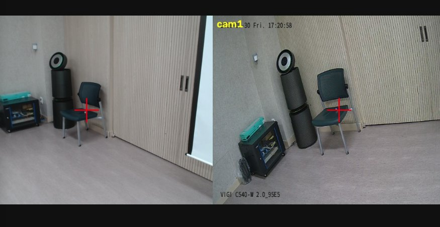
*preview_cams.py 화면. 왼쪽 cam0(USB), 오른쪽 cam1(IP). 빨간 십자 = 카메라 정면, 바닥의 흰 점 = 기준점 포스트잇*

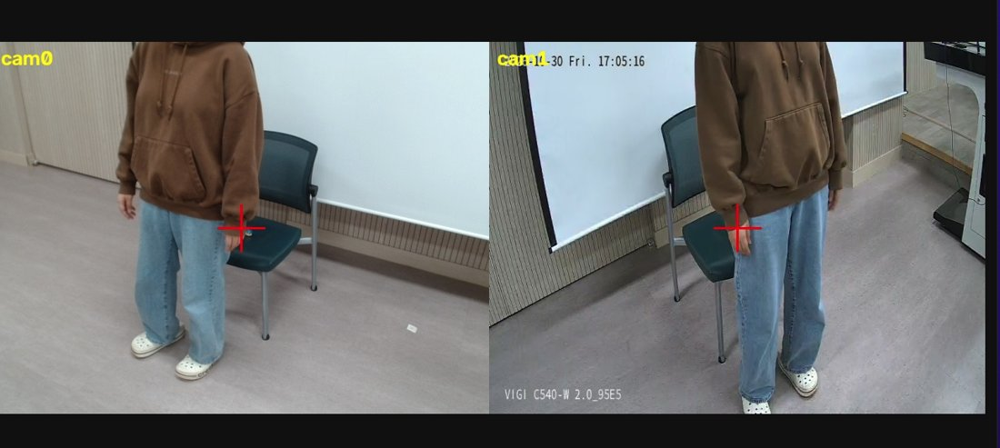
*각도 조정 전 확인 화면. 머리가 잘려 있어 두 카메라를 위로 조금 올렸다(어깨가 두 화면에 모두 보여야 삼각측량 가능)*

기준점 14개(계산용 12개 + 검증용 C, d): 바닥 A~H 8개, 의자 등받이 a·b(0.85 m), 의자 좌판 c·d(0.45 m), 벽 e(1.45 m)·f(1.25 m).

| 항목 | cam0 USB | cam1 IP | 기준 |
| --- | --- | --- | --- |
| 재투영 평균 mean_px | 6.64 | 5.57 | 3 이하 |
| 가장 큰 점 | e 16.7 px | a 11.0 px | |
| 계산 위치 (m) | (0.93, 0.82, 1.01) | (0.30, 1.56, 1.20) | |
| 줄자 위치 (m) | (0, 0, 1.45) | (0, 1.40, 1.45) | |
| 차이 | 131 cm | 42 cm | 20 cm 이내 |

두 카메라 삼각측량 오차(줄자 좌표와의 차이, cm): B 1.4, E 1.5, f 3.5, c 3.9, b 3.9, D 5.1, F 5.8, e 6.3, H 7.3, a 8.3, G 9.7, **C 11.2(검증)**, A 18.9, **d 21.2(검증)**.

- 기준 미달이지만 실습은 그대로 진행했다(지원 님 결정). 실제 위치 계산에 쓰는 삼각측량 오차가 14개 중 11개에서 10 cm 이하였기 때문이다.
- 두 장소 모두 계산된 카메라 높이가 실측보다 40 cm 이상 낮았다. 줄자 측정(카메라 위치, 기준점 좌표) 쪽 오차인지 클릭 오차인지는 확인하지 못했다. 이 높이 오차가 10-5의 실패로 이어졌다.
- 설치 조건의 한계: 두 카메라가 같은 벽에 1.4 m 간격으로 있어서 의자 위치에서 두 시선 사이 각도가 약 18도로 작다(권장 60~90도). 렌즈 높이 1.45 m도 서 있는 사람 어깨(1.3~1.4 m)와 거의 같다.

### 10-3 ~ 10-5 실행 기록

타겟 = 의자 좌판 가운데 (2.4, 3.0) 직접 지정, `--near 1.0`(기본), `--far 2.0`. 3 m는 이 공간에서 카메라 범위를 벗어나 2 m로 줄였다.

#### 10-3 ankle1 (카메라 1대 + 발목)

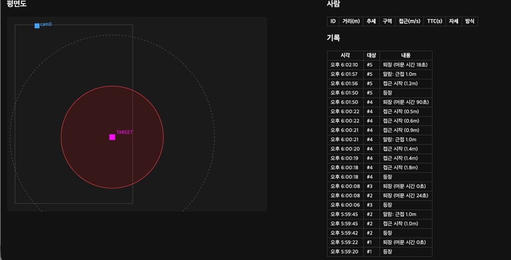
*10-3 첫 실행. 근접 알람은 뜨지만 #4의 '접근 시작'이 4초 동안 여러 번 찍혔고, 이탈 알람 없이 '퇴장'으로 끝난다*

- 근접 알람은 1.0 m 안에서 정상으로 떴다(#2, #4, #5).
- '접근 시작'이 여러 번 찍혔다. #4는 4초 동안 1.8 → 0.5 m로 6번 찍혔다. 지원 님 확인 결과 실제로 여러 번 다가갔다.
- 이탈 알람(2.0 m)은 한 번도 뜨지 않았다. 2 m 밖으로 가기 전에 화면 밖으로 나가거나 발목이 안 보여서 '퇴장'으로 끝났다.
- 머문 시간 0초로 바로 사라지는 짧은 트랙(#1, #3)이 있었다. 화면 가장자리에서 잠깐 잡힌 경우다.

#### 10-4 stereo (두 카메라 + 어깨 삼각측량)

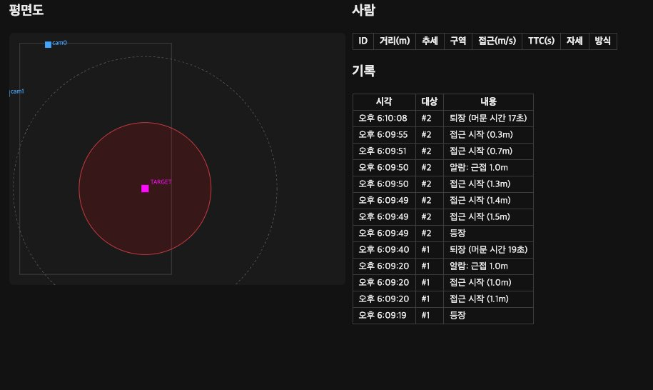
*10-4 실행 기록. 평면도에 cam1(왼쪽 가장자리)이 추가로 보인다*

- 의자 옆에 서 있을 때 거리 0.54 m, 자세 '섬'으로 맞게 나왔다.
- 근접 알람 정상(#1 0.5 m, #2 1.0 m, 0.2 m까지 접근 기록).
- 카메라 쪽으로 가까이 오면 위치가 사라졌다. 한쪽 화면에서 몸이 잘리면 두 카메라 짝이 안 맞기 때문이다. 발목이 가려지는 것과는 상관없다(stereo는 발목을 안 씀).

#### 10-5 fused (stereo + 한 카메라 추정)

| 의자 옆 (두 카메라 모두 보임) | 카메라 가까이 (위치 없음) |
| --- | --- |
| 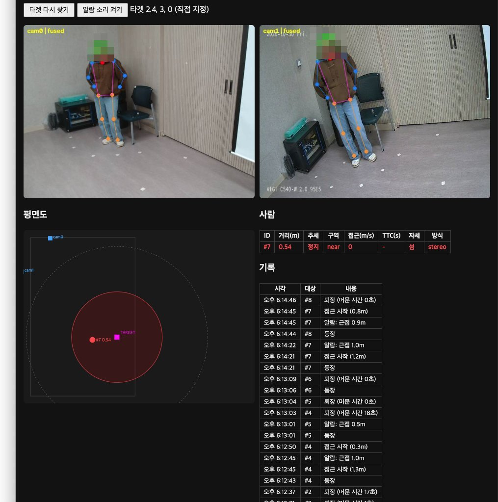 | 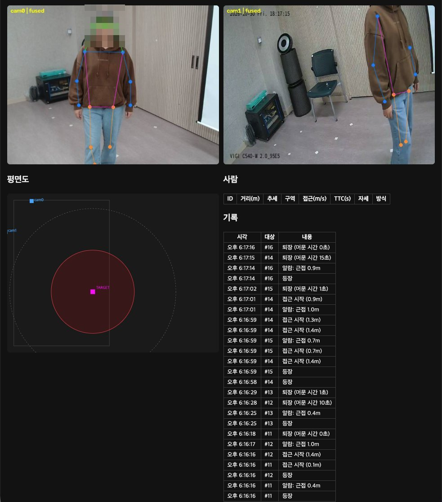 |
| stereo, 타겟까지 0.54 m, 섬, near | 두 화면에 관절이 잡혔는데 '사람' 표가 비어 있다 |

- 의자 근처에서는 stereo와 같다.
- 한 카메라에만 보일 때의 노란 점(single)은 처음 한 번만 나오고 이후 나오지 않았다. 두 화면에 모두 보이는데 카메라 가까이에서 위치가 없는 경우도 있었다.
- 원인: single은 시선이 높이 1.2 m(가정한 어깨 높이)에 닿는 곳을 위치로 잡는다. 그런데 10-2에서 카메라 높이가 1.01 / 1.20 m로 계산돼, 카메라가 그 높이보다 낮거나 같다. 아래를 내려다보는 시선은 1.2 m 높이에 닿지 않아 계산 결과가 '없음'이 된다. 카메라 가까이에서 두 화면에 다 보이는데 사라지는 것은, 보정 오차 때문에 재투영 오차가 짝짓기 기준(15 px)을 넘은 것으로 보인다.
- 고치려면 10-2를 다시 해서 카메라 높이가 실측(1.45 m)에 가깝게 나와야 하고, 카메라를 어깨보다 확실히 높은 곳(1.8 m 이상)에 두는 것이 좋다.

### 10-6 타겟 자동 찾기

`--target "chair"`

| 타겟 찾음 | 걸어서 접근 |
| --- | --- |
| 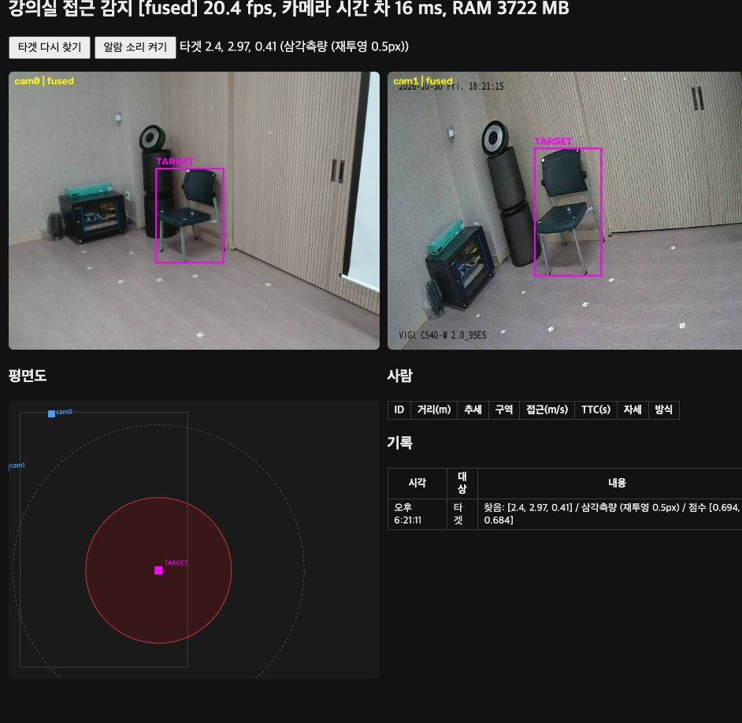 | 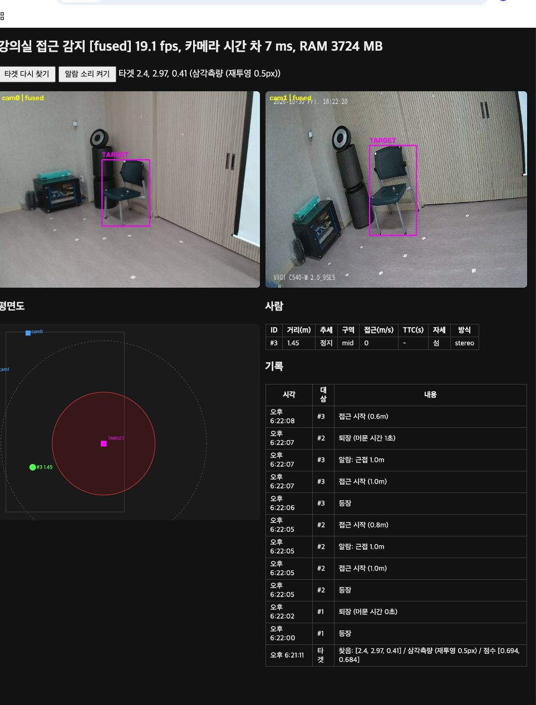 |
| 두 카메라 모두 의자에 TARGET 박스, (2.4, 2.97, 0.41) 삼각측량 0.5 px | 같은 타겟으로 근접·접근 알람 기록 |

| 항목 | 값 |
| --- | --- |
| 찾은 방식 | 두 카메라 모두 → 삼각측량 |
| 점수 (cam0, cam1) | 0.694, 0.684 (기준 0.15) |
| 위치 (m) | (2.40, 2.97), 높이 0.41 |
| 재투영 오차 | 0.5 px |
| 줄자 좌표와 차이 | 3 cm (좌판 높이 0.45 m와도 비슷) |
| 속도 / 메모리 | 19.1~20.4 fps, RAM 3.7 GB |

- 글로 찾은 타겟으로도 알람이 똑같이 떴다(#2, #3: 1.0 m 근접, 0.6~0.8 m 접근 시작).
- 의자 상자 중심은 사람 어깨보다 훨씬 작고 선명해서, 사람 위치보다 삼각측량이 잘 맞았다(재투영 0.5 px).

### 10-7 비교

#### 방식별 거리 (같은 테이프 지점, 타겟까지 m)

| ankle1 | stereo | fused |
| --- | --- | --- |
| 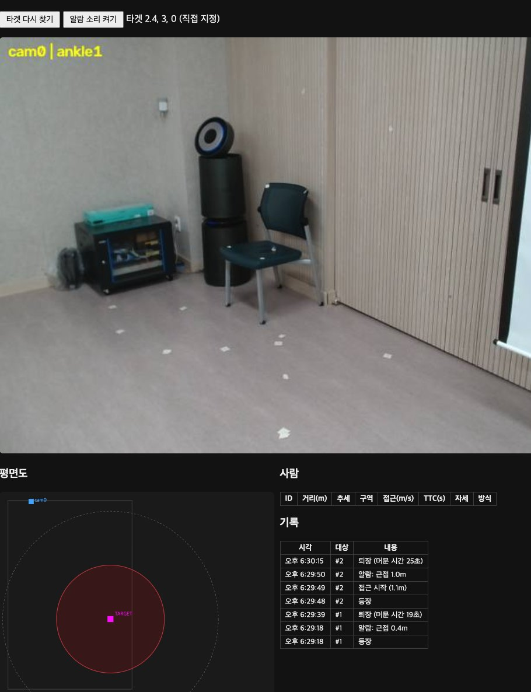 | 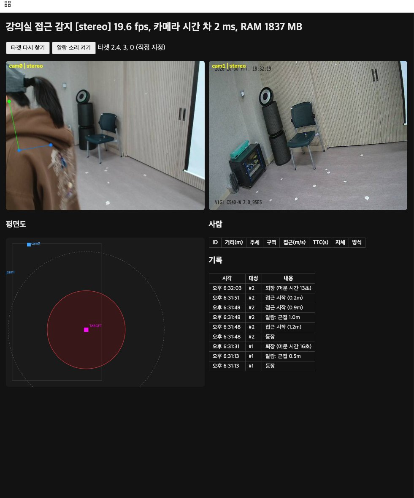 | 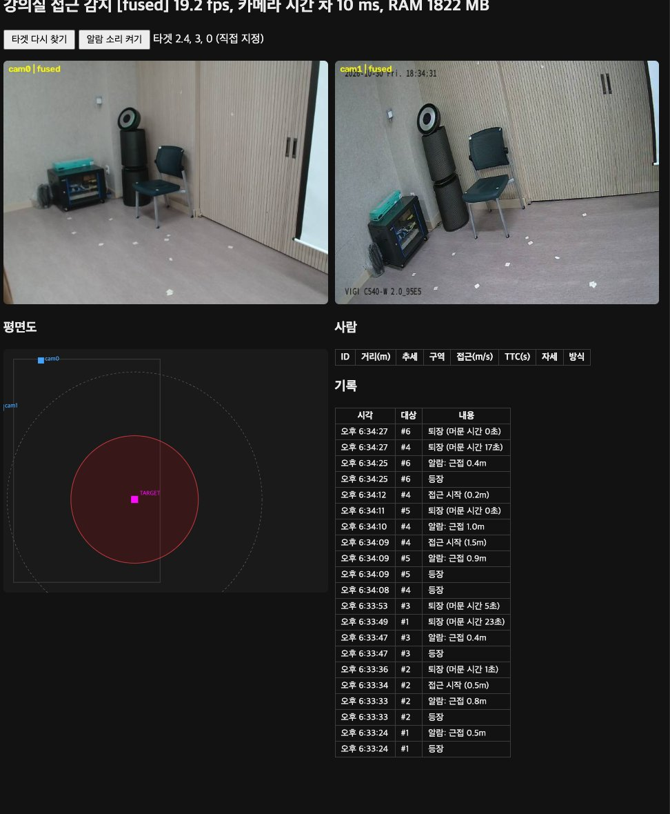 |
| 24.7 fps · 1941 MB | 19.6 fps · 2 ms · 1837 MB | 19.2 fps · 10 ms · 1822 MB |

*같은 순서(0.5 → 1.0 → 1.5 → 2.0 m 서기 → 앉기 → 한 카메라에만 보이기)로 돌린 뒤의 기록 표. stereo 화면의 cam0은 카메라 바로 앞에 선 순간이라 한쪽에만 보여 위치가 없다*

| 실제 거리·자세 | ankle1 (10-3) | stereo (10-4) | fused (10-5) |
| --- | --- | --- | --- |
| 0.5m, 서 있음 | 0.4 (근접 알람 거리) | 0.5 | 0.4~0.5 |
| 1.0m, 서 있음 | 1.0~1.1 | 1.0~1.2 | 0.8~1.0 |
| 1.5m, 서 있음 | 미기록 | 미기록 | 1.5 (#4 접근 시작) |
| 2.0m, 서 있음 | 미기록 | 미기록 | 미기록 |
| 의자에 앉음 | 미기록 | 미기록 | 미기록 |
| 한 카메라에만 보이는 위치 | (1대 방식) | 없음 | 없음 (single 미동작) |

- 값은 기록 표의 알람·접근 시작 거리에서 읽었다. 미기록 칸은 실행 중 '사람' 표 값을 받지 못한 곳이다.
- README의 3.0 m는 이 공간에서 카메라 범위 밖이라 1.5 m로 바꿨다. 책상이 없어 '책상에 앉음'은 '의자에 앉음', '책상 뒤'는 생략했다.

#### 속도·메모리

| 모드 | fps | 카메라 시간 차 (ms) | RAM (MB) |
| --- | --- | --- | --- |
| ankle1 | 24.7 | 0 (카메라 1대) | 1941 |
| stereo | 19.6 | 2 | 1837 |
| fused | 19.2 | 10 | 1822 |
| fused + 글 타겟(10-6) | 19.1~20.4 | 7~16 | 3722 |

- 카메라 2대를 쓰면 1대보다 약 5 fps 느려진다(관절 추정을 두 장 함께 처리).
- 10-6은 YOLOE와 EmbeddingGemma 2를 추가로 올려 RAM이 약 1.9 GB 늘었다.
- IP 카메라 지연에도 불구하고 카메라 시간 차는 2~16 ms로 작았다(`--lag` 없이 실행). README 기준 80 ms보다 충분히 작다.

### 배운 점

1. 위치 보정의 질은 기준점 배치가 좌우한다. 한곳에 몰린 점은 카메라 위치를 50 cm 이상 틀리게 한다. 넓게, 높이를 섞어 퍼뜨려야 한다.
2. 보정 숫자(mean_px, 카메라 위치)가 나빠도 타겟 근처의 삼각측량은 쓸 만했다. 하지만 카메라 가까이나 한 카메라 추정처럼 보정 오차가 커지는 곳에서는 바로 무너졌다.
3. 카메라 설치 조건(높이 1.8 m 이상, 시선 각도 60~90도)은 계산 방식의 전제다. 카메라 높이가 가정한 어깨 높이보다 낮으면 한 카메라 추정(10-5)은 원리상 동작할 수 없다.
4. 물체(의자)는 사람보다 삼각측량이 잘 맞는다. 박스 중심이 안정적이기 때문이다.

## 8. 공용 장비 원칙과 결정 기록

여러 학생이 한 장비를 쓰므로, 장비 전체에 영향을 주는 변경은 최소로 하고 범위를 기록했다.

| 결정 | 이유 | 영향 범위 |
| --- | --- | --- |
| 설치를 `system_setup.sh`(관리자) + `user_setup.sh`(계정별)로 분리 | 개인 과제라 venv와 결과는 계정마다 따로, 모델 파일만 공용 | 시스템: apt 패키지, 성능 모드, 스왑, `/ssd/hf` 그룹 권한 / 나머지는 계정별 |
| 모델 캐시 `/ssd/hf` 공용 | 모델은 읽기만 하므로 공유해도 결과가 섞이지 않고, 계정당 3 GB 절약 | `aiplab` 그룹 |
| 장비 FFmpeg(NVIDIA판)를 바꾸지 않음 | Ubuntu 라이브러리를 섞으면 충돌할 수 있고 다른 학생에게도 영향 | 없음 |
| torchcodec, PyAV, ultralytics, CLIP 등은 venv에만, `-c torch-pin.txt`로 설치 | Jetson용 torch가 일반판으로 덮어쓰이는 것을 막음 | 내 계정만 |
| espeak-ng 대신 맥북 `say`, lavfi 대신 `make_sounds.py` | sudo apt 설치 회피, 장비 FFmpeg에 기능 없음 | 없음 |
| NumPy 1.26.4 → 2.4.6 | 7단계 datasets(pyarrow 26)가 NumPy 2 요구 | 내 계정만 |
| eg2.py MODEL_ID를 미세 조정 모델로 바꾸지 않음 | 미세 조정 모델은 텍스트 전용이라 8단계 이후 이미지 검색에 못 씀 | 없음 |
| IP 카메라용 `camlink` 네트워크 연결 | 무선 연결 불가로 유선 직결 | 장비 전체이지만 LAN 포트에만 해당, 와이파이·Tailscale 영향 없음. `sudo nmcli connection delete camlink`로 되돌림 |
| 사람 이미지 저장 안 함 | 9·10단계는 관절 좌표와 위치 숫자만 저장. 보고서 캡처의 얼굴은 모자이크 | 개인정보 |

## 9. 종합 결론과 한계

### 배운 점

1. **임베딩 검색은 "의미가 분명한 차이"에 강하다.** 단어가 겹치지 않아도 의미로 찾았고(3단계), 사람 있음/없음·경보음/잡음은 잘 가렸다. 개수 세기, 소리 종류, 바꿔 말한 표현은 약했다(4·5단계). 사진·소리 점수는 0.58~0.70의 좁은 구간에 몰려 문턱값을 정하기 어렵다.
2. **Jetson 8 GB에서는 메모리 고정비가 크다.** 프로세스마다 약 1.7 GB가 CUDA·PyTorch 비용이다. 전체 구성도 4.7 GB로 들어가지만 여러 학생이 동시에 쓰면 부족하다(6단계).
3. **작은 데이터로도 도메인 미세 조정 효과가 크다.** 282쌍, 4.3분 학습으로 1위 정답률이 0.850 → 0.933이 됐고, 128차원이 학습 전 768차원과 같은 점수를 냈다(7단계).
4. **임베딩은 검출기의 모르는 클래스를 보완한다.** 재라벨은 추가 학습 없이 COCO 밖 물체 라벨을 바로잡았고, YOLOE는 이름만으로 새 물체를 검출했다. 박스가 잡히지 않는 물체는 둘 다 못 고친다(8단계).
5. **시간 정보와 다수결이 깜빡임을 없앤다.** 규칙·모델 모두 프레임 단위 판정은 횟수를 부풀렸다(9단계).
6. **학습 모델은 배운 라벨 안에서만 답한다.** 모르는 동작에도 확신하며 아는 라벨을 골랐고, 데이터가 적으면 "멈춤 = 관심" 같은 지름길을 배웠다. 기준이 분명한 문제는 규칙이, 규칙으로 적기 어려운 동작은 학습이 나았다(9단계).
7. **다중 카메라 위치 계산은 설치와 보정이 전부다.** 기준점 배치가 카메라 위치 오차를 좌우했고, 카메라가 가정한 어깨 높이보다 낮게 계산되면 한 카메라 추정은 원리상 동작하지 않았다. 물체는 박스 중심이 안정적이라 사람보다 정확했다(10단계).

### 한계

- 평가 데이터가 작다: 사진 5장, 소리 3개, 7단계 평가 60쌍, 9단계 녹화자 1명, 행동 시나리오 1번씩.
- 8단계 yolo 모드 fps와 모드별 RAM은 기록하지 못했다.
- 10-2 위치 보정이 기준(재투영 3 px, 위치 20 cm)에 미달한 채 진행했다. 10-7 일부 거리 칸은 미기록이다.
- 10-8(이동 타겟, 칼만 필터)은 밀어 줄 사람과 카트가 필요해 하지 않았다.

### 더 해 볼 것

- 10-2를 다시 하고 카메라를 1.8 m 이상, 시선 각도 60~90도로 설치해 fused 모드 재확인
- 9단계를 녹화에 참여하지 않은 사람으로 평가, 행동 모델에 머무름·걷기 라벨 추가
- 8단계 확장 과제(yoloe 박스 + 재라벨), 10단계 알람 MQTT 발행

## 10. 제출 파일 구성

| 단계 | 파일 |
| --- | --- |
| 1~2 | `setup/system_setup.sh`, `setup/user_setup.sh`, `setup/jetson_setup.sh`(최초 단일 계정용), `lab/check.py`, `lab/eg2.py` |
| 3~6 | `lab/test_text.py`, `lab/test_vision.py`, `lab/make_sounds.py`, `lab/test_audio.py`, `lab/measure.py` |
| 7 | `lab/eval_ir.py`, `lab/train_ft.py`, `lab/data/train.jsonl`, `lab/data/eval.jsonl` (학습 모델 1.1 GB는 제외) |
| 8 | `lab/app.py` |
| 9 | `lab/pose_model.py`, `lab/pose_app.py`, `lab/train_pose.py`, `lab/data/action/wave.csv` |
| 10 | `lab/prox/` (stereo.py, calib_intrinsics.py, calib_extrinsics.py, proximity_app.py, preview_cams.py, ptz.py, find_rtsp.py, calib/world_points.json, 체커보드 PDF) |
| 보고서 | 이 문서, 단계별 원본 결과(`results_step8.md`, `results_step9.md`, `results_step10.md`, `실습보고서_3-5단계.md`), 스크린샷 `img/step10/` |

모든 .py와 .sh 파일 맨 위에 수정 기록(날짜, 무엇을, 왜)을 주석으로 남겼다. 파일별 역할과 실행 방법은 `docs/실습파일안내.md`, 단계별 개념 정리는 `docs/기초개념_학습노트.md`에 있다.
